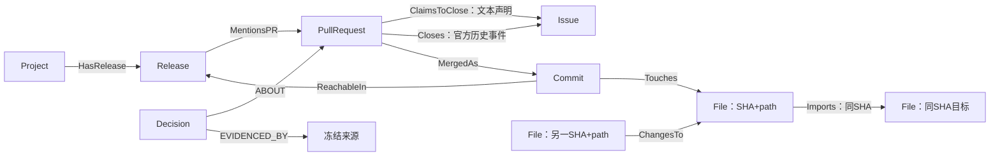

# 图模式与可追溯查询：报告方法草稿

写作口径：2026-10-30实际实现；公共契约1.4.1。真实Flask问答、正式实验结果和Windows
验证尚待统一流程运行，本稿描述已实现方法及当前工程证据，不填写预期实验数字。

## 可直接并入方法章节的正文

开源项目的讨论、合并记录、发布说明与源码分别承载不同证据。仅检索讨论能够定位
参与者的解释，却未必同时覆盖实际提交和文件；仅查看代码差异又无法确定改动理由。
本项目在P4移植的relore 0.3.19基础上组织统一来源池，利用其已有的讨论索引与词法排序，
新增来源证据映射和显式图扩展。relore的上游定位是带作者、出处等信息的项目历史检索，
并提供与代码资料结合的入口[1]；本项目的贡献在于课程任务所需的冻结数据契约、
实体关系组织、证据约束及受控对照，不将上游能力计为自行发明。

图的业务实体限定为Project、Issue、PullRequest、Commit、File、Release和Decision。
其中File表示完整提交SHA下的单个文件快照；同一路径不同SHA保存为不同实体。
Release身份由仓库与原样tag确定，因此同一提交上的不同tag不会合并。讨论评论和
API响应保存在来源表，不为每条评论额外建立业务实体。Decision通过ABOUT连接已有主体，
通过EVIDENCED_BY指向来源；没有理由时保留有证据的结论和理由缺口，没有Decision时
也保留Issue、PR、提交与文件的客观关联。

关系按证据性质拆分。PR正文中的Fixes或Closes声明记为ClaimsToClose；官方关闭事件
能够核验对象并关联该PR或其已核实合并提交时，才接受Closes。GitHub文档说明，
closed事件中的commit_id存在时表示通过关闭语法关闭该Issue的提交[2]；当前closed状态
与普通提及均不能替代该历史事件。MergedAs、Touches分别表达合并提交与受影响文件，
MentionsPR只表示发布说明提及，ReachableIn只表示提交对tag可达。程序与回答提示均
保留这些区别，不把关闭、合并或notes提及直接写成功能修复或首次发布。

导入前统一检查来源哈希、Unicode码点偏移、稳定ID、端点、关系方向和数据集归属。
每条事实关系必须有可复算证据，错误记录导致整批拒收。Neo4j使用(dataset_id,id)组合
唯一约束及带dataset_id的参数化遍历；组合唯一约束保证的是属性组合的唯一性[3]。
相同冻结包重复导入保持节点、关系与属性一致，同数据集标识下内容变化则拒收并要求
建立新版本。写入在事务中完成，发布前再次读回全部记录并比较冻结指纹。

为使旧数据集不受后续采集更新影响，系统为每个dataset在现有PostgreSQL实例中建立
独立relore空间。load阶段从冻结ThreadPayload无网络回放，逐个核对讨论对象与来源正文，
并保存可迁移的回放输入。查询只访问对应冻结索引。共同来源适配层对讨论、发布说明、
提交说明、代码、git输出和API响应使用固定词法规则，按source_id稳定打破同分；
该排名与真实relore命中通过固定倒数排名规则合并，并保留底座命中和映射记录。

公共查询入口接收自然语言问题，按主体目录、当前仓库编号或URL及检索命中的证据
解析共同种子。A组使用共同检索，B组在相同种子上增加最多三跳的真实图路径扩展；
两组始终使用同一个冻结来源池、回答器、模型参数和提示。B只改变证据选择，不增加
A不可见的原文。两组最终均调用P4的同一渲染函数，以Python len计算12000 Unicode
码点上限，来源标题和结构同时计入。长片段按句或行裁剪，并同步end与quote。

回答器输出原子claims及原文引文，公共查询层核验引文确实落在最终可见上下文内，
再装配证据与关系路径。界面只连接claims正文，不附加未经审查的summary。每次查询
保存候选、真实底座结果、最终上下文、模型运行标识及用量，使后续证据召回按实际
送入模型的片段计算。无证据返回empty，范围缺资料返回unsupported，数据库、解析
或模型故障返回error；运行失败不计为正确弃答。

## 当前工程证据与仍待填入的结果

首批14项由主代理独立复跑通过；同日接缝修复后P2实际Neo4j/Postgres测试为16项通过。
其中包括同repo原对象更新后旧dataset命中与排名不变、无Decision仍有修改链、
声明不升级关闭、跨dataset拒收、断库error以及最终上下文偏移一致性。
回答接缝测试使用P4实际回答器和明确的无付费网关替身，只证明接口与裁剪可用。
上述属于工程验证，不代替抽取质量、下游A/B、真实跨源问答与架构职责题的实验。
结果部分随后引用P6独立统计和真实生产查询run_id，不预设图增强获胜。

## 显式图模式（关系均须有实际记录）

## 已核验引用

1. huggingface. *relore 0.3.19* [CP/OL]. 固定源码
   06a1c99c4653e9db899a18e96d8ff0ee6b419815；本项目保存于vendor/relore。
   [维护者发布页](https://pypi.org/project/relore/0.3.19/)，访问日期2026-10-30。
   本文只引用其检索定位与出处元数据；排序细节以仓库固定源码及本项目适配实现为准。
2. GitHub. *Issue event types: closed* [EB/OL].
   [官方API事件语义](https://docs.github.com/en/rest/using-the-rest-api/issue-event-types#closed)，
   访问日期2026-10-30。
3. Neo4j. *Cypher Manual: Create property uniqueness constraints* [EB/OL].
   [组合唯一约束](https://neo4j.com/docs/cypher-manual/current/schema/constraints/create-constraints/)，
   访问日期2026-10-30。本次运行实际版本5.26.0；引用用于约束语义，版本可用性由实测佐证。

本方法实际实现及限制见[公共接口说明](../../../docs/graph_query.md)，
验证和交接见[handoff](handoff.md)。
