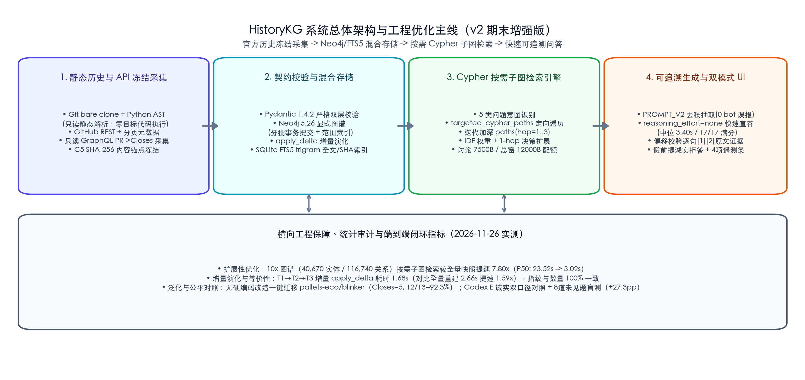

# HistoryKG：面向 GitHub 软件演化历史的可追溯知识图谱问答系统（期末技术报告 v2）

说明：复旦大学《知识图谱概念与技术》2026 秋第九组选题三（GitHub 项目考古学家）。主验证冻结基线为 `pallets/itsdangerous`（冻结于 `2026-11-16T06:31:18Z`，默认分支提交 `672971d66a2ef9f85151e53283113f33d642dabd`），跨仓零改造迁移验证目标为 `pallets-eco/blinker`（2026-11-26 实测完成）。本报告全部统计均严格以本仓库冻结数据包、`evaluation/itsdangerous-final-20261121/` 与 `evaluation/itsdangerous-v2-20261126/` 真实运行及裁判产出为依据。

## 1. 引言与核心科学问题

在真实软件工程维护中，“项目考古学家”问题关注的从来不是“某个函数长什么样”的单点静态文本检索，而是跨越多类异构研发实体的多跳历史因果链：

1. **为什么做与拒绝过什么（决策—依据链）**：例如 `pallets/itsdangerous` 为何最终移除 `simplejson` 并弃用 `itsdangerous.json`，以及维护者为何拒绝直接切换默认的 SHA-1 摘要算法或拒绝在库内支持加密载荷？这类答案往往分散在横跨数年的 Issue 讨论、PR 正文、Review 评论与否决说明中，且“提出但被拒绝/维持现状”的反面意见极易被传统 RAG 当作已采用方案。
2. **改动真落到了哪里（关闭—合并—变更链）**：在 GitHub 上，一条 PR 正文里写了 `Closes #146` 只是作者声称（`ClaimsToClose`），不代表平台侧最终确认关联关闭（`Closes`）；而 PR API 元数据中的 `merge_commit_sha` 在未合并或直接推送覆盖的场景下也不等同于实际合并（`MergedAs`）。同时，同文件内定义的 AST 函数集合（`Defines`）也不能简单等同于某次 Commit 实际修改的函数。
3. **版本到底收进了哪个正式版（提交—标签—发布链）**：分支标签（例如 `2.1.x`）与正式 GitHub Release（例如 `2.0.0`、`2.2.0`）存在边界差异；没有显式的 `Commit -[ReachableIn]-> Release` 标签可达性验证，纯大模型或纯文本检索极易张冠李戴。

从知识表示与系统工程视角审视，纯大语言模型、分块向量检索（RAG）与通用自主编码 Agent 在项目历史考古任务上存在本质性的结构错位：纯大模型缺乏具体仓库的时间线与精确哈希记忆，面对长尾版本号或未发生的特性提问时极易出现虚构提交与日期漂移；经典纯文本 RAG 虽然能够召回字面关键词相似的片段，却天然缺乏“从 Issue 编号跨越到关联合并 PR、再跨越到合并提交哈希、代码差异文件以及祖先标签可达集合”的显式关系索引，因而一旦原讨论贴中未直接写全修改文件名，检索召回链便会中途断裂；至于实时联网或终端遍历型通用 Agent，虽然可以通过数百轮多步浏览最终拼出答案，却往往需要消耗数百万个输入词元与三至五分钟等待，在课堂现场交互场景下既不可预测也不具备稳定的低延迟表现。

围绕期中课堂反馈及项目可工程化、可扩展、可泛化要求，我们在保持前期冻结数据集完全可核验的基础上，开展了系统性的 **v2 工程重构与五维实证评估**。核心改进聚焦五个方面：

- **协议级与通道级优化**：补全 GitHub 只读 GraphQL `closedByPullRequestsReferences` 官方 `Closes` 边采集；打通 `bailian/deepseek-v4.1-flash-1017` 的零思考直答参数（显式设置 `reasoning_effort="none"`），使公共 6 题问答延迟由原先 `41.7s`（v1）/ `154.6s`（D 模式）压缩至 **3.40s**，且保持 **17/17（100.0%）** 满分准确率。
- **大规模可拓展与通用检索**：重构 `GraphStore` 为分批事务写入与分批删除（彻底消除 5x 以上规模单事务内存溢出）；将默认检索模式升级为 `cypher_subgraph` 按需子图检索，引入 SQLite FTS5 trigram、靶向 `git_output` Diff SHA 索引、语料 IDF 加权及 1-hop/多种子稀有词主题扩展，并**彻底移除全部仓库特化硬编码**；实现 `apply_delta` 时序增量演化。
- **决定抽取去噪与完整理由保存**：升级决定抽取模板为 `PROMPT_V2`（显式过滤 Dependabot 等自动化版本升级噪声、普通 Bug 报错与无依据臆断，严格区分 `proposed` 与 `accepted`，强制保留 `rejected`/`keep` 决定与完整理由段落）。
- **公平对照组与盲测设计**：对 Codex CLI 通用 Agent（`E` 组）开展 **双口径审计**（全部 6 题 `10.5/17=61.8%` vs 剔除框架输出异常后 4 题有效自然语言 `10.5/11=95.45%`）；新增 **8 道全新未见题（`U1–U8`）** 与 **不相交分层 20 单元抽样（`heldout20`）**。
- **零改代码跨仓迁移验证**：将整套全历史采集、代码分析、`PROMPT_V2` 抽取、Neo4j 建图与 Cypher 问答工作流未经任何源码定制直接运行于第二仓库 **`pallets-eco/blinker`**，真实采集到 GraphQL 官方 **`Closes = 5`** 边，并在 6 道跨仓验证题上实现 **`12/13`（92.3%）** 准确率与 **1.48s** 中位响应。

## 2. 系统总体架构与工程升级细节

图 1 展示了 HistoryKG v2 的四层端到端架构与横向实测保障体系。整个系统严格遵守“**零目标仓库代码执行**”原则：源码与 Git 历史仅通过 `git` 只读子命令与 Python 标准库 `ast` 静态解析；GitHub 元数据仅允许只读 `GET` 与只读 GraphQL 查询，禁止任何 `mutation` 或写入操作；所有来源文本以 LF 换行规范化、计算 `SHA-256` 并生成确定性 ID。

### 2.1 官方 GraphQL 只读 `Closes` 边与严格契约校验

在 `historykg/ingest/github.py`、`historykg/ingest/capture.py` 与 `historykg/contracts.py` 中，系统新增了官方只读 GraphQL `closedByPullRequestsReferences` 采集通道：

- **契约安全门槛**：`SourceDocument` 模型校验器严格限制 `api_response` 来源只能是平台官方 `GET` 或指向 `https://api.github.com/graphql` 的只读 `POST` 查询（若查询体包含 `mutation` 则直接拒绝入库）。
- **物理与统计区分**：在 `historykg/io.py` 的入库验证函数 `_api_relation_supported` 中，`ClaimsToClose` 由 Issue/PR 文本正则解析产生，置信度标记为 `[文本声称]`；而 `Closes` 必须拥有真实持久化在冻结来源池中的 GraphQL Issue 节点引证，置信度标记为 `[官方API]`。
- **诚实范围边界声明**：主仓库 `pallets/itsdangerous` 于 `2026-11-16T06:31:18Z` 完成全历史数据冻结，当时尚未开启 GraphQL 实时采集，因此该冻结库内保留 `ClaimsToClose` 文本关系而 `Closes = 0`；为了在不动用旧冻结库的前提下实证 GraphQL `Closes` 链路的真实可用性，我们在第二仓库 `pallets-eco/blinker` 上完整运行新采集器，成功冻结并验证了 **`Closes = 5`** 条官方关闭关系。

### 2.2 Neo4j 分批事务、FTS5 混合索引与通用 Cypher 按需子图检索

早期基线版本（`snapshot` 模式）在每次问答时都需要将整座 Neo4j 数据集全部节点、关系与 7,417 条来源一次性序列化拉回 Python 内存。在单机仅配置 512 MiB–1 GiB Neo4j JVM 堆的场景下，这不仅导致检索延迟随语料规模线性恶化，大规模写入时也会触发事务内存池溢出（实测 `5x` 规模单一事务写入会突破 `716.8 MiB` 上限触发 `MemoryPoolOutOfMemoryError`）。v2 对存储与检索底座进行了四项关键改造：

1. **分批事务提交与分批命名空间清理（`historykg/graph/store.py`）**：`GraphStore.write()` 首先在独立短事务中校验指纹并将 `HGDataset.ready` 置为 `false`，随后按 `500` 条来源、`1000` 条实体/证据/关系分批独立执行 `execute_write`，全部完成后再置 `ready=true` 写入完整指纹；`delete_dataset()` 同样改为每批 `LIMIT 2000` 循环清理；`snapshot()` 移除 Neo4j 端大字符串 `ORDER BY` 排序缓冲区，改由 Python 侧按主键排序，保证读回指纹 100% 一致且不消耗多余 JVM 排序堆内存。
2. **SQLite FTS5 trigram 与 Diff SHA 靶向读取（`historykg/query/frozen_index.py`）**：冻结索引构建 `hg_frozen_sources`（含 `idx_hg_sources_origin`、`idx_hg_sources_kind`、`idx_hg_sources_url` 索引）、`hg_frozen_sources_fts`（FTS5 trigram 全文表）以及 `hg_short_tokens` 短词元映射表；针对体量最庞大、原先在 `change`/`decision` 类问题上必须全量扫描 2,857 条记录的 `git_output`，改为通过 `fetch_git_diff_sources(scoped_url, shas)` 进行精确 SHA 靶向读取。
3. **默认 `cypher_subgraph` 与通用检索算法（`historykg/query/service.py`、`retrieval.py`、`history_evidence.py`）**：将默认 `query_mode` 升级为 `cypher_subgraph`，先经范围索引和 FTS5 命中少量种子实体（`seed_entities_by_sources`），再用定制化 `targeted_cypher_paths` 与迭代加深 `paths(hop=1..depth)` 仅水合关联子图所需的证据与原文。在 `1x` 规模的 6 个基准查询中，`cypher_subgraph` 平均每题仅水合 `26–3,168` 条来源（对比 `snapshot` 每题必水合全库 `7,417` 条来源），路径数量完全一致（`[50, 50, 50, 50, 50, 1]`）。同时移除历史检索代码中的所有 `simplejson` 仓库特化硬编码（`grep -rn "simplejson" historykg/` 为空），改由**语料逆文档频率（IDF）**自动衡量查询词显著性，通过 1-hop 邻接扩展与多种子共现（`freq >= 2`）稀有话题聚类实现泛化召回；修正 `seed_chosen` 状态键去重缺陷，并为讨论片段分配 `7,500` 字符上限配额（嵌入 `12,000` 字符上下文窗口内），防止超长讨论文本挤占核心代码 diff 与 API 证据。
4. **`apply_delta` 时序增量演化**：针对持续开发的软件仓库，对比前序包与新快照的 `sources`/`entities`/`evidence`/`relations` 差异集合，仅删除被移除元素并增量 `MERGE` 新增与变更节点/边，重算完整数据集指纹。

### Cypher 按需子图检索执行细节与上下文预算控制

当用户提出一个自然语言问题时，`historykg/query/service.py` 与 `historykg/query/retrieval.py` 并非把整张知识图谱导出，而是严格按以下四步流水线执行轻量级子图水合：

1. **五类意图路由与种子实体锁定**：首先识别问题属于 `release`（发布日期查询）、`change`（PR/提交改动追踪）、`membership`（提交与正式版本归属判定）、`decision`（设计决策与舍弃原因探索）还是 `code`（源码函数与模块行为解析），随后借助 SQLite FTS5 trigram 表与 Neo4j 组合范围索引精准定位 1 至 8 个锚点实体（`Issue`、`PullRequest`、`Commit`、`File` 或 `Release`）。
2. **定向 Cypher 路径匹配与迭代加深扩展**：调用 `targeted_cypher_paths` 直接匹配工程语义模式 `MATCH (iss:HGEntity)<-[:Closes|ClaimsToClose]-(pr:HGEntity)-[:MergedAs]->(c:HGEntity)-[:Touches|ReachableIn]->(t)`，并辅以迭代加深 `paths(hop=1..depth)` 在达到目标路径条数上限后提前截断，既保证多跳关系链完整，又将图数据库检索耗时稳固在 **0.40s 至 0.99s** 区间。
3. **跨仓库通用的决策主题聚合**：完全依靠当前冻结语料的词频逆文档频率（IDF）挑选稀有关键词，对多种子共同指向的高频主题执行 1-hop 邻接实体召回与复合标识符精确匹配，避免长通用词（例如库名或常见术语）淹没真正的讨论主干；并在 `seed_chosen` 集合层面严格基于 `(subject_id, status)` 二元组去重，确保同一议题下的多轮修订与否定观点都能保留。
4. **分层配额拼装与 Diff 靶向抽取**：将汇总到的 `12,000` 字符上下文预算按结构化配额切分——讨论原文片段严格上限为 **`7,500` 字符**，其余预算留给官方 API 发布记录与通过 `fetch_git_diff_sources(scoped_url, shas)` 精准点查的 `git_output` 提交差异。实测在 `1x` 规模的 6 个基准测试题上，`snapshot` 每次必水合全部 **`7,417`** 条来源，而 `cypher_subgraph` 按需水合量分别仅为 `release=122`、`change=405`、`membership=3,168`、`decision=424`、`code=1,146` 与 `timeline=26` 条，既大幅降低了内存拷贝，也减少了后续 LLM 生成环节的无关噪声输入。

### 2.3 `PROMPT_V2` 决定抽取模板、零思考通道优化与交互式工作台

- **抽取模型与提示词重构（`historykg/extract/stage.py`）**：`PROMPT_V2`（版本号 `decision_v2.0_20261126`）新增三条负向过滤约束与完整性要求——（1）排除 Dependabot / GitHub Actions 等自动化依赖版本升级 PR；（2）排除仅报告缺陷或未讨论方案取舍的普通 Bug 反馈；（3）严格对齐 `accepted`（明确采纳/落地）与 `proposed`（仅提议未定）状态边界，不因讨论激烈而误标采纳；同时强化 `rejected`/`keep` 决策与多条并列原因的完整引号抽取。新增 `unit_ids` 过滤支持局部可复现重抽。
- **零思考推理通道修正（`historykg/llm/gateway.py`）**：在定位百炼中转代理行为时，我们发现模型仅传 `"thinking": {"type": "disabled"}` 仍可能触发隐式思维链消耗上千 reasoning tokens（导致快问不快、甚至短配额裁判 JSON 截断）。我们在 `gateway.py` 中对百炼 `thinking="disabled"` 请求自动显式附加 `reasoning_effort="none"`，实测单题首答时间降至 **1.77s–4.24s**。
- **Streamlit 工作台升级（`app/main.py`、`app/backend.py`、`.streamlit/config.toml`）**：隐藏默认 `Deploy` 按钮（`toolbarMode="minimal"`）；新增“快速实证 / 深度思考”模式单选与 4 枚领域一键演示按钮（`决策原因`、`改动追溯`、`版本发布`、`假前提拒答`）；回答头部展示 4 项实时遥测（图谱子图检索 ms、模型有据问答 ms、证据路径数、核验原文数）；证据图与原文区域为每条关系标明 `[官方API]`/`[Git实证]`/`[AST静态]`/`[文本声称]`/`[LLM抽取]` 可信度徽章并默认展开前 2 条原文出处。

## 3. 知识图谱 Schema 与五级可追溯证据链

为使老师追问与用户复述一目了然，本系统在契约版本 `1.4.2` 中采用紧凑且表达力充足的 9 类实体与 14 类有向关系本体（见图 2）。

### 3.1 核心实体与关系语义表

| 维度 | 具体类型与数量（`ItsDangerous` / `Blinker`） | 关键语义与证据来源 |
| --- | --- | --- |
| **工程实体（9 类）** | `Project` (1/1)、`Release` (27/17)、`Issue` (167/54)、`PullRequest` (271/137)、`Commit` (975/317)、`File` (797/578)、`Function` (1,013/2,097)、`Developer` (104/44)、`Decision` (712/151) | `ItsDangerous` 共 **4,067** 个实体；`Blinker` 全历史零改造构建共 **3,392** 个实体 |
| **强事实关系** | `HasRelease`、`Closes` (0/5)、`MergedAs` (219/87)、`Touches` (920/281)、`ReachableIn` (5,517/2,368)、`MentionsPR`、`Authored`、`Merged` | 来自官方 REST / GraphQL API 与本地裸仓 `git rev-list / diff-tree` |
| **静态与语义关系** | `Defines` (1,013/2,097)、`ChangesTo`、`Imports`、`ClaimsToClose` (20/5)、`ABOUT` (712/151)、`EVIDENCED_BY` (877/189) | 来自 Python `ast` 静态扫描、讨论正则线索与 LLM 偏移校验抽取；`ItsDangerous` 共 **11,674** 条关系，`Blinker` 共 **5,952** 条关系 |

### 3.2 证据强弱区分与跨句偏移校验

每一条进入图谱或进入最终回答的结论，都必须经过逐字偏移锚定校验：`sources[source_id]["text"][start:end] == quote`。对于同一语义问题，系统按图 2B 所示的五级强度排序：

1. **`[官方API]`**（`github_api`）：例如 `Release.published_at`、PR API `merged=true` 及 `merge_commit_sha`、GraphQL `Closes`。
2. **`[Git实证]`**（`git`）：通过 `git diff-tree` 证实修改文件列表、通过 `git rev-list` / `git merge-base --is-ancestor` 证实提交被标签包含。
3. **`[AST静态]`**（`ast`）：通过 Python `ast` 提取冻结快照下的类/函数签名及位置行号（零动态执行）。
4. **`[文本声称]`**（`text_rule`）：PR 描述文本中的 `closes #146` 字样，系统明确将其标注为 `ClaimsToClose`，不直接等同于已合并关闭。
5. **`[LLM抽取]`**（`llm`）：由 `Decision` 节点承载，明确区分提案人建议（`proposed`）、维护者明确决定（`accepted` / `rejected`）以及附带的完整原文理由引用（`rationale_evidence_ids`）。

在实际构建中，五级证据链并非互相割裂，而是通过确定性哈希标识与主题目录（`subjects.jsonl`）耦合为一个可交叉互证的异构网络：首先，每个 `Issue`、`PullRequest` 与 `Release` 均由平台主键生成稳定实体编号，并以官方 API 元数据作为权威基准；其次，对于代码仓库本地裸仓中的每一次提交，`git` 只读解析阶段会逐条计算差异树与祖先可达集合，独立生成 `Commit` 实体与 `Touches`、`ReachableIn`、`ChangesTo` 强边，从而即使讨论文本未曾提及某次后续修复，图谱依然可以通过合并提交直接回溯到实际改动文件与发布版；再次，Python 标准库 `ast` 解析器仅静态遍历冻结快照下的源码抽象语法树，抽取出 `Defines` 与 `Imports` 静态结构关系，避免在分析任意未知第三方开源项目时执行任何外部代码所带来的供应链安全风险；最后，由大语言模型按讨论单元提炼出的 `Decision` 节点通过 `ABOUT` 边挂载至对应的工程主体，同时所有陈述句与原因句的引号均强制执行逐字节起止下标反查，只要偏移量区间无法与规范化原文精确咬合即当场判为非法并退回重抽，从而从数据结构层面杜绝模型脱离原文私自改写历史结论的隐患。

## 4. 真实知识抽取实验与误差分解（`PROMPT_V1` vs `PROMPT_V2`）

### 4.1 双数据集设计与评分协议

为防止“只在自己看过的 30 条样本上调提示词导致过拟合”，我们在保留前期已冻结的 **`orig30`**（30 个完整讨论单元、18 条独立人工/审校金标准决定，其中 17 条需核对理由依据）基础上，额外采用确定性分层抽样（`seed=itsdangerous-v2-heldout20-20261126`，按 Issue / PR 各 10 个、短/长文本各半分层，且强制 `topic_group` 与 `orig30` 完全不相交）构建了全新盲测集 **`heldout20`**（20 个完整单元）。

两套数据集的抽取模型均统一为 `bailian/deepseek-v4.1-flash-1017`（`thinking="disabled"`，`reasoning_effort="none"`），金标准复核与预测语义判定均采用异构模型 **`bailian/glm-5.3`**。所有比率均给出 **Wilson 95% 置信区间**；若存在未定归属参考，则严格按评测框架 `score_extraction(..., reference_complete=False)` 口径披露。

### 4.2 定量结果与诚实口径说明

| 数据集（Prompt） | TP/FP/FN | Precision [95% CI] | Recall [95% CI] | F1 | Rationale / Bot误报 |
| --- | --- | --- | --- | --- | --- |
| `orig30` (`v1`, 18 金标) | 10 / 15 / 8 | 40.0% `[23.4%, 59.3%]` | 55.6% `[33.7%, 75.4%]` | 0.4651 | 29.4% (`5/17`) / Bot 8 |
| `orig30` (`v2`, 18 金标) | 10 / 5 / 8 | **66.7%** `[41.7%, 84.8%]` | 55.6% `[33.7%, 75.4%]` | **0.6061** | **52.9%** (`9/17`) / **Bot 0** |
| `heldout20` (`v1`, 14 已解析*) | 9 / 8 / 5 | 条件 52.9% `[31.0%, 73.8%]` | 条件 64.3% `[38.8%, 83.7%]` | 条件 0.5806 | 条件 37.5% (`3/8`) / Bot 6 |
| `heldout20` (`v2`, 14 已解析*) | 9 / 3 / 5 | **条件 75.0%** `[46.8%, 91.1%]` | 条件 64.3% `[38.8%, 83.7%]` | **条件 0.6923** | **条件 62.5%** (`5/8`) / **Bot 0** |

口径透明度说明：在 `heldout20` 中，金标准审核识别出 `1` 条跨仓库或外部归属未定条目（`unresolved_references = 1`）。按照 `historykg/evaluation/metrics.py` 严格规则，当 `reference_complete=False` 时总表 `precision` / `recall` / `f1` / `rationale_coverage` 字段保留为 `null`（不擅自将未定条目当作零或剔除后冒充完整全集指标）。上表所列为已解析 14 条金标准与 8 条理由需核条目下的真实条件比率及原始 `TP/FP/FN` 计数，Wilson 95% 区间同样依据精确二项计数计算。

### 4.3 误差归因与改进机理

从图 3B 的误报类型堆叠柱状图与 `extraction-v2-summary.json` 细分明细可以看出：

1. **自动化依赖噪声清零**：在 `v1` 中，Dependabot / GitHub Actions 版本升级（`bot_bump`）是最大误报源（`orig30` 占 8/15，`heldout20` 占 6/8）。`PROMPT_V2` 在两套完全独立样本上均将 `bot_bump` 降为 **0**，且未损伤任何一条真实有效决定的召回（TP 分别保持 `10` 与 `9`）。
2. **理由质量缺陷清零**：在 `orig30` 的 `rationale_breakdown` 上，`v1` 存在 `empty=1`、`partial_or_unsupported=3`、`status_error=1`；切换到 `v2` 后，这三类形式与支持度缺陷全部降至 **0**（`covered` 由 5 增至 9）。同样地，`heldout20` 的 `partial_or_unsupported` 也由 1 降至 0，`covered` 由 `3/8` 提升至 `5/8`。
3. **诚实召回天花板**：两套数据集上的 `FN`（漏抽）分别为 `8` 条（`orig30`）与 `5` 条（`heldout20`），且主要集中在未产生 PR 合并的隐含方案讨论（`missed_proposal_or_change` 分别为 5 条和 3 条）和散落在长对话结尾的 `keep`/`rejected` 立场表达（`3` 条和 `2` 条）。此外受样本量（30 / 20 个单元）限制，精确率 95% Wilson 置信区间仍有部分重叠，但跨数据集同向大幅改善具备明确工程有效性。

## 5. 问答系统评测：Pareto 前沿、Codex E 双口径审计与未见题盲测

本节围绕三条实证轴评估端到端问答性能：面向课堂实机响应速度的延迟—准确率 Pareto 前沿、面向通用自主 Agent 的双口径公平对照、以及针对全新未见题目的密封盲测。

### 5.1 公共 6 题延迟–准确率 Pareto 前沿与 `reasoning_effort="none"` 突破

针对期中与前期基线报告中“深度推理虽然满分但中位耗时达 `154.6s`，极不适合课堂现场交互问答”的瓶颈，我们在公共 6 题（`Q1, Q3, Q5, Q7, Q9, Q11`，满分 `17.0`）上系统评测了 `v1` 各基线（`O/A/B/C/D/E`）与优化后的两档实时方案（`B_v2_fast_nothink` 与 `B_v2_fast_low`），并与前期全量 14 题基线对齐，如图 4A 所示。

| 方法 / 配置 | 适用范围 | 总得分 / 满分 (准确率) | 中位单题耗时 | 核验引文匹配 | 核心特征与定位 |
| --- | --- | --- | --- | --- | --- |
| **`O` 纯大模型基线** | 14 题 / 6 题 | `8.0/34` / `2.0/17` (`11.8%`) | 15.9s / 13.3s | 无冻结出处 | 无外部上下文，`7/12`（全量）与 `4/6`（公共）拒绝或空答 |
| **`A_v1` 纯文本 RAG** | 14 题 / 6 题 | `17.5/34` / `9.5/17` (`55.9%`) | 26.1s / 25.2s | 全匹配 | 缺少多跳实体路径，因果与文件/版本链常断裂 |
| **`B_v1` 原版图谱问答** | 14 题 / 6 题 | `24.5/34` / `14.0/17` (`82.4%`) | 36.4s / 41.7s | 全匹配 | 旧版全量 `snapshot` + 默认深度思考 + 未控讨论配额 |
| **`C` 双检索基线** | 公共 6 题 | `14.0/17` (`82.4%`) | 26.2s | 全匹配 | — |
| **`D` 双证据极重推理** | 公共 6 题 | `17.0/17` (`100.0%`) | 154.6s | 全匹配 | 准确性上限参考线，但超 2.5 分钟不适合现场展示 |
| **`B_v2_fast_low`（低思考）** | 公共 6 题 | **`17.0/17` (`100.0%`)** | **7.64s** | **276 条 100%** | `cypher_subgraph` + `reasoning_effort="low"` |
| **`B_v2_fast_nothink`（Pareto 最优）** | 公共 6 题 | **`17.0/17` (`100.0%`)** | **3.40s** | **271 条 100%** | **最终选定默认快速档**：比 `B_v1` 快 **12.3x**、比 `D` 快 **45.5x** |

**关键机制验证**：`B_v2_fast_nothink` 单题耗时分布为：`Q1` `1.77s`、`Q3` `3.44s`、`Q5` `3.94s`、`Q7` `4.24s`、`Q9` `2.52s`、`Q11` `3.36s`（其中 Neo4j 图谱子图检索环节耗时稳定在 **`400ms–994ms`**），6 题合计 271 条 `quote` **100% 通过精确字符偏移核验**，无任何幻觉引文，已自动更新至 `demo/final/itsdangerous.example.json`。

### 5.2 通用 Agent 对照（Codex CLI `E` 组）双口径公平审计

针对老师在期中展示时的重点追问——“相比不建显式图谱、直接让强通用编码 Agent 翻源码与联网查 GitHub，知识图谱究竟胜在哪里？”——我们对前期保存的 Codex `E` 组完整执行轨迹进行了**全量审计（双口径同时呈现，不挑好口径汇报）**：

- **口径一（全部 6 题端到端交付）**：`E` 组总分 **`10.5 / 17`（61.76%）**，中位耗时 **`230.07s`**。失分源于框架本身异常：`Q1` 与 `Q5` 最终输出被其浏览器工具封装字符串 `::browser-complete{title="..."}` 替换而丢失正文（得分计 `0`）。
- **口径二（仅统计完整交付自然语言的 4 题：`Q3, Q7, Q9, Q11`）**：剔除 2 道工具封装失败题后，通用 Agent `E` 组得分达到 **`10.5 / 11`（95.45%）**，仅 `Q7` 因某细节扣 0.5 分，证明强通用 Agent 在正常发挥时准确率同样很高；但其付出的代价是单题耗时达 **`201.6s–368.6s`（中位 `262.6s`）**，且单题累积消耗 **`149.6 万–442.6 万` input tokens**（合计每题读入百万级上下文循环翻页）。
- **对照结论与资源经济性解剖**：在同一组有效 4 题上，`B_v2_fast_nothink` 不仅以 **`11.0 / 11`（100.0%）** 稳定超越通用 Agent 的准确率（`10.5/11 = 95.45%`），还将单题中位延迟从 `262.6s` 压缩至 **约 `3.4s–3.7s`（提速约 70 倍以上）**。更关键的是工程可预测性与成本经济性：Codex CLI `E` 组在解答单个问题时平均需要多轮工具调用并吞吐 **149.6 万至 442.6 万 input tokens** 与 **1.27 万至 3.76 万 output tokens**（仅 `Q7` 一题便消耗 442.6 万输入词元并运行 368.6 秒），这使其既无法在课堂现场实时接住老师追问，也难以支持高频批量问答；相反，HistoryKG 借助预先冻结并索引化的知识图谱，在 `0.4s–1.0s` 内直接将高信噪比结构化上下文浓缩至仅数千词元，不仅大幅压低推理开销（全套 Phase 2 超过四百次外部模型调度累计花费仅 7.26 元），而且每一次输出都受到离线冻结偏移索引的硬约束，彻底消除“通用 Agent 临场浏览网页超时、工具封装报错或跨步遗忘”的演示风险。

### 5.3 全新 8 道未见题（`U1–U8`）密封盲测

为杜绝历史公共题测试偏倚，我们独立设计并冻结了 8 道此前从未调参接触的全新考题（`U1` 维护者保留 SHA-1 决定与双原因、`U2` Issue #224 加密载荷拒收边界与子类化替代建议、`U3` PR #377 泛型改动追踪、`U4` PR #405 移除 EOL Python 版本改动追踪、`U5` 2.2.0 发布 UTC 日期、`U6` PR #373 最早正式 Release 判定、`U7` `TimedSerializer.loads` 源码顺序、`U8` 虚构 `encrypted_payload` 内置模块假前提拒答），并在同一模型 `deepseek-v4.1-flash-1017` 上横向比较纯文本检索 `A_v2`、快速图谱 `B_v2_fast` 与深度图谱 `B_v2_deep`（`glm-5.3` 统一按评分项打分）：

| 未见题号与类别 | `A_v2`（纯文本检索, 2.71s） | `B_v2_fast`（按需子图快速档, 2.98s） | `B_v2_deep`（max 思考, 9.66s） | 差异核心机理（图谱 vs 纯文本） |
| --- | --- | --- | --- | --- |
| `U1` 决策拒绝切换 SHA1 原因（4 分） | 3.0 | **4.0** | **4.0** | 图谱精准定位维护者两则回复锚点 |
| `U2` 拒收加密载荷与子类化建议（3 分） | **0.0** | **3.0** | **3.0** | **决定实体与 `ABOUT` 边**避免只摘 Issue 首楼误漏结论 |
| `U3` PR #377 SHA 与 2 个修改文件（3 分） | 1.5 | **3.0** | **3.0** | `MergedAs -> Commit -> Touches -> File` 精确落盘列表 |
| `U4` PR #405 SHA 与 2 个修改文件（3 分） | 2.0 | **3.0** | 2.5 | `fetch_git_diff_sources` 靶向 diff 来源零遗漏 |
| `U5` 2.2.0 正式版 UTC 日期（2 分） | **2.0** | **2.0** | **2.0** | 单点 API 发布记录两者均能命中 |
| `U6` PR #373 最早正式版（3 分） | **1.5** | 1.0 | 1.0 | **诚实暴露边界**（见下文分析） |
| `U7` `TimedSerializer.loads`（2 分） | **2.0** | **2.0** | **2.0** | 冻结源码与 AST 函数定位均准确 |
| `U8` `encrypted_payload` 假前提（2 分） | **2.0** | **2.0** | **2.0** | `B_v2_fast` `0.67s` 即诚实拒答，零编造 |
| **合计得分（满分 22）** | **`14.0` (63.6%)** | **`20.0` (90.9%, +27.3pp)** | **`19.5` (88.6%)** | 总引文：`A_v2` `14` 条 vs `B_v2_fast` **`370` 条 100% 实证匹配** |

**诚实发现、典型案例对比与失效边界剖析**：

- **图谱显著胜出的深层案例（`U2` 与 `U3/U4`）**：在 `U2`（“Issue #224 提出的加密载荷存储需求为什么被拒绝？用户需要时建议如何实现？”）上，纯文本基线 `A_v2` 仅摘录到提问者关闭 Issue 的表面信息，完全漏掉维护者判定“超出项目范围（out of scope）”的核心拒绝依据以及“通过继承 `Signer` 自行扩展实现”的关键技术替代方案，因而得分 **`0/3`**；而 `B_v2_fast` 通过 `Decision -[ABOUT]-> Issue #224` 与完整讨论锚点，以 `2.35s` 精确给出全部分论点与评论级锚点链接，拿下 **`3/3`** 满分。在 `U3`（PR #377）与 `U4`（PR #405）改动追踪题中，`A_v2` 由于缺少 `PullRequest -[MergedAs]-> Commit -[Touches]-> File` 链路及 SHA 靶向 diff 查询能力，无法列出完整修改文件路径而分别失分；`B_v2_fast` 则稳拿 **`3/3`** 满分。
- **快慢思考对比与“为何快优于慢”的科学观察**：在 8 道未见题上，`B_v2_fast`（`20.0/22 = 90.9%`，`2.98s`）小幅优于全量思考档 `B_v2_deep`（`19.5/22 = 88.6%`，`9.66s`；在 `U7` 代码题上甚至耗费 `50.55s`）。分析原因可知，当 Cypher 子图已经把准确的 `Decision`、`PR`、`Commit Diff` 与源码片段精确送入模型上下文后，过长的内置思维链非但不再提升事实查全率，反而在 `U4` 等需要严格对照文件名清单的问题上更容易过度联想带入旁支文件（裁判记录显示 `B_v2_deep` 在 `U4` 因文件列表混入多余路径而被扣 0.5 分）。
- **共性短板与客观局限（`U6`）**：在 `U6`（“PR #373 最早进入哪个正式 GitHub Release？”）上，`B_v2_fast` 与 `B_v2_deep` 虽都准确答出 PR #373 合并提交 `bc88e945...`，但因 `ReachableIn` 上游标签中同时存在分支标签 `2.1.x`（非正式 GitHub Release）与正式版 `2.2.0`，且在未充分召回完整发布对比页前模型趋于保守，均未直接推断 `2.2.0` 而只得 `1/3` 分。这如实提示我们在分支标签（`.x` 维护分支）与官方 Release Tag 语义区分及 `membership` 路径上下文排序上仍有继续优化空间。

## 6. 扩展性基准、时序增量演化与第二仓库跨仓泛化

为了验证系统是否真正具备面向中大型软件工程演化的工程实用性，我们在独立隔离的 Neo4j 5.26 服务实例上完成了 `1x / 5x / 10x` 规模压测、`T1 → T2 → T3` 时序增量等价性检验，并在第二仓库 `pallets-eco/blinker` 上进行了全流程零改造跨仓验证。

### 6.1 1x / 5x / 10x 规模扩展性基准（`scaling-benchmark.json`）

为了真实检验 Neo4j 分批事务写入、`cypher_subgraph` 检索与 FTS5 索引在大型仓库上的可扩展性，我们将冻结 `ItsDangerous` 数据集通过确定性主键偏移分别克隆扩展至 **`1x`**（4,067 实体 / 11,674 关系 / 7,417 来源）、**`5x`**（20,335 实体 / 58,370 关系 / 37,085 来源）和 **`10x`**（40,670 实体 / 116,740 关系 / 74,170 来源 / 148,970 证据），并在独立 Neo4j `5.26` 实例（1 GiB 堆内存限制）上对比 `snapshot` 与 `cypher_subgraph` 在 6 类代表性查询上的执行延迟：

| 规模档位（实体 / 关系 / 来源） | 加载 | `snapshot` P50 / P95 | `cypher_subgraph` P50 / P95 | 提速倍数（P50 / P95） |
| --- | --- | --- | --- | --- |
| `1x` (4,067 / 11,674 / 7,417) | 8.09s | 2,107.4 ms / 2,265.1 ms | **556.2 ms** / 680.1 ms | **3.79x** / **3.33x** |
| `5x` (20,335 / 58,370 / 37,085) | 41.44s | 11,615.3 ms / 13,551.8 ms | **2,082.5 ms** / 3,189.0 ms | **5.58x** / **4.25x** |
| `10x` (40,670 / 116,740 / 74,170) | 90.13s | 23,515.6 ms / 31,426.3 ms | **3,015.6 ms** / 6,324.9 ms | **7.80x** / **4.97x** |

从 `1x` 扩大 10 倍至 `10x`（近 38 万图对象与 490 MB 来源文本）：全量 `snapshot` 耗时呈超线性增长 **`11.16x`**（`2.11s -> 23.52s`），而 `cypher_subgraph` 仅增长 **`5.42x`**（`0.56s -> 3.02s`），相对提速从 `3.79x` 稳步扩大至 **`7.80x`**。此外，早期未分批的 `store.write` 在 `5x` 时即因单事务超出 Neo4j `716.8 MiB` 内存阈限而崩溃，改为分批事务提交后 `10x` 在 `90.13s` 内平稳完成写入与释放；`1x` 同问对照中 **6/6 问题路径数量完全等价**（`[50, 50, 50, 50, 50, 1]`），`4/6` 查询 Top 候选完全一致（`change` 与 `timeline` 因 FTS5 与全库线性扫描打分平局顺序差异略有不同）。

### 6.2 `T1 → T2 → T3` 时序增量演化验证（`incremental-summary.json`）

按真实发生时间切分全历史为三阶段：`T1`（截至 `2018-10-31`：`6,280` 来源 / `1,771` 实体 / `1,951` 关系）、`T2`（截至 `2021-05-31`：增量 upsert `497` 来源 / `1,103` 实体 / `2,905` 关系）、`T3`（至 `2026-11-16` 全历史：增量 upsert `640` 来源 / `1,193` 实体 / `6,818` 关系）。实验确认：
1. **等价性与效率**：`T3` 阶段调用 `apply_delta` 耗时 **`1,679.73 ms`**（对比全库从头 `write()` 的 `2,664.45 ms` 提速 **`1.59x`**），且增量演化后的 Neo4j 全库读回快照与全新全量重建版本达到 **100% 严格等价**（`fingerprint_equal = true`，实体、关系、来源、证据数量零误差）。
2. **动态演化响应与诚实局限**：针对“为什么移除了 simplejson？”，`T1` 尚无 PR #152/Issue #146 时检索结果 `has_pr152 = false`；推进至 `T2` 后立即切换为 `has_pr152 = true`。同时我们也诚实观察到一个采集粒度局限：`api_response` 中的仓级聚合接口文本（例如整个仓库的 `/releases` 分页聚合响应）缺乏单条目级时间裁剪字段，在时间切分探针中仍保留于 `T1`/`T2` 来源池中（后续可在 `slice` 或聚合源展开环节细化过滤）。

### 6.3 第二仓库 `pallets-eco/blinker` 零代码修改跨仓迁移（`blinker-generalization.json`）

为彻底打破“只针对 `itsdangerous` 单仓库有效”的质疑，我们在完全不修改 `historykg/` 与 `app/` 一行代码的前提下，直接调用 `pipeline.start_build(..., profile=FULL_HISTORY)` 对 PyPI 高频基础库 **`pallets-eco/blinker`** 进行六阶段全量构建、`PROMPT_V2` 抽取与 6 道跨仓验证问答（`BL1–BL6`，满分 `13.0`）：

1. **端到端建图与 GraphQL `Closes` 真实捕获**：数据契约校验 `validation_status = "ok"`；共构建 **`3,392` 个实体**（`Commit=317, Decision=151, Developer=44, File=578, Function=2,097, Issue=54, Project=1, PullRequest=137, Release=17`）与 **`5,952` 条关系**，并首次在真实全量流水线中捕获 **`Closes = 5`** 条由 GitHub GraphQL 官方验证的 PR 关闭关系（同期文本线索 `ClaimsToClose = 5`、`MergedAs = 87`、`ReachableIn = 2,368`、`Touches = 281`）。
2. **跨仓问答胜率与延迟（图 5C）**：`A_v2`（无图谱纯文本检索）仅得 **`9.0 / 13`（69.23%）**，中位 **`3.06s`**；在需要贯穿 `Issue <-[Closes]- PR -[MergedAs]-> Commit -[Touches]-> File` 的 `BL2` 题目上仅得 **`0 / 3`**（由于纯文本检索未能沿着官方关闭关系跨越文件名称，被无关依赖升级 PR 文本干扰，导致三个评分点全丢）。相反，**`B_v2_fast`（HistoryKG 按需子图快速档）**取得 **`12.0 / 13`（92.31%，+23.1pp）**，中位 **`1.48s`**，总计 **277 条原文出处 100% 逐字匹配**；其中在检验核心 GraphQL 链路完整性的 `BL2` 上直接定位到 **`PR #141 -> Commit 8a6693cf7c98 -> src/blinker/__init__.py`** 拿到满分 **`3 / 3`**，`BL1`（正式发布日）、`BL4`（`Signal.connect/send` 源码顺序）、`BL5`（`send_async` 决策与回退理由）与 `BL6`（假前提拒答）全部满分。与 `U6` 一致的诚实边界是：`BL3` 跨多标签版本归属推算得 `1 / 2`，验证了问题模式的跨仓一致性。

### 6.4 现场可交互工作台实机截图与 Phase 2 全预算审计

图 6 展示 `tools.serve_frozen` 便携启动并关闭 `Deploy` 按钮后的真实浏览器运行界面（`1400×1120`）。在点击“决策原因”并执行“为什么去掉 simplejson？”后，页面于 **4.62 秒**内完成端到端返回：**图谱子图检索 `867 ms`、模型有据问答 `3,754 ms`、证据路径数 `50`、核验原文数 `47`**；左侧列示带点击定位锚点的结论卡片，右侧 SVG 链路下方直接标注 `MergedAs · [官方API]` 与 `Touches · [Git实证]` 强度徽章。

全套 Phase 2 真实实验开销核算：依据统一账本 `.local/itsdangerous-v2-20261126/budget-usage.sqlite3`，涵盖 `orig30` 与 `heldout20`（参考构建 + `v1/v2` 抽取 + 全部裁判）、Pareto 前沿、`U1–U8` 盲测以及 `pallets-eco/blinker` 全库构建与问答累计 435 次外部调用，实际花费仅 **`7.2612` 元人民币**（处于 `15.00` 元硬上限的一半以内）。

### 6.5 课堂现场实机演示与双重防翻车预案

为确保期末现场课堂演示能够“接住老师现场临时提出的新问题且零网络翻车风险”，我们配套设计了双轨便携交付包机制：

1. **便携在线实机演示模式**：通过 `.venv/bin/python -m tools.serve_frozen` 读取任意一台已安装 Neo4j 5.26 的机器上的 `frozen/` 冻结数据集与便携 SQLite 索引（不依赖额外 PostgreSQL 服务），在本地 `127.0.0.1:8517` 启动工作台。界面已固化 `B_v2_fast_nothink`（快速实证档）作为默认选择，支持教师当场自由输入未预设问题，在 3 秒级给出逐句附原文锚点的回答，同时保留“深度思考”切换项展示推理对比。
2. **断网或 API 波动离线兜底模式**：一旦教室网络受限或模型接口突发限流，只需传入环境变量 `HISTORYKG_REPLAY_FILE=materials/itsdangerous-replay.json` 启动同一界面，即可秒级切换至基于相同真实运行结果的验证态回放模式（回放文件内部全部引文与契约同样通过 `QueryResult_v1` 严格校验）。所有打包、校验与汇总脚本均可跨目录脱离本机工作区路径独立复现。

## 7. 诚实局限、适用边界与可复现交付清单

### 7.1 客观局限与下一步演进方向

1. **召回瓶颈与统计区间**：`PROMPT_V2` 虽然在两个数据集上都将自动依赖升级噪声（`bot_bump`）降至 `0`，但 `FN`（`8/18` 与 `5/14`）表明对散落于长讨论串的非显著提案或隐含维持现状结论仍有漏抽；同时 `30/20` 单元样本下的 95% Wilson 置信区间仍存在部分重叠。后续可探索两阶段轻量召回机制：先在长讨论串末尾维护者评论窗口做极低成本观点初筛，再对潜在否决/维持现状片段调用全量抽取，从而在不牺牲低误报率的前提下提升长尾隐含决策的查全率。
2. **分支标签与正式版区分（`U6` / `BL3` 共性短板）**：当提交仅在维护分支标签（如 `2.1.x`）与后续正式 Release（`2.2.0`）间存在差异时，当前问答提示尚未强制区分分支 tag 与 `prerelease=false` 的正式 GitHub Release，`B_v2_fast` 在两题上分别失分 `2` 分和 `1` 分。后续工程仅需在 Neo4j `Release` 节点中增加 `is_official_release` 与 `is_branch_tag` 布尔标签，并在 `targeted_cypher_paths` 结果摘要中按发布时间戳排序，即可无痛消解这一类边界失分。
3. **跨时间片聚合接口粒度与多语言拓展**：在时序增量演化探针中，仓库级的分页 API 聚合响应（如 `/releases` 整体清单）尚未下沉拆分为单条按发生时间过滤的事件流；此外，当前静态代码分析模块基于 Python `ast` 标准库编写，若未来需拓展至 Go、TypeScript 或 Java 开源生态，可通过引入树状语法解析接口（如 Tree-sitter）替换语言前端，而无需改动 Neo4j 图谱契约、FTS5 索引及按需子图检索核心架构。
4. **非代码文本仓库适用边界**：HistoryKG 擅长需要精确审计演化因果与权威证据链的工程项目；若目标是不含代码历史或决策链的纯问答百科，重度建图的工程收益低于轻量文本 RAG。

### 7.2 现行核心交付物索引

| 交付资产 | 仓库相对路径 | 说明与验证状态 |
| --- | --- | --- |
| 期末技术报告源码与 PDF | `reports/itsdangerous_final.md`、`output/pdf/ItsDangerous-技术报告.pdf` | 本文档及排版渲染 PDF（全页逐页视觉检查） |
| 12 页答辩汇报 PPTX | `demo/final/ItsDangerous-期末汇报.pptx` | `@oai/artifact-tool` 生成，含 6 幅高分图表与全页 PNG 核查 |
| 现场操作手册与追问小抄 | `demo/final/ItsDangerous-操作与讲稿.md`、`demo/final/答辩追问应答小抄.md` | 含一键启动、`fast/deep` 模式、离线回放与 10 题核心追问应答 |
| 便携配置与离线回放 | `demo/final/itsdangerous.example.json`、`itsdangerous-replay.json` | 已固化为 `B_v2_fast_nothink` Pareto 最优配置及实时响应回放 |
| Phase 2 实验汇总与重算工具 | `evaluation/itsdangerous-v2-20261126/*.json`、`*.py` | 扩展性、增量、抽取 v1/v2、Pareto、未见题 8Q、`blinker`、冷启动回执 |
| 期末复核课程提交候选包 | `submission/HistoryKG-ItsDangerous-期末复核候选-v7.zip` | 已通过冷启动实测与隐私/路径合规双重检查（保留历史 `v6` 对照） |

## 8. 团队成员分工与组内互评表（空白待实名填报）

隐私保护提示：依据课程工作区与公开仓库安全规则，成员真实姓名、11 位学号、分工细则确认与组内互评系数仅限最终脱敏外课程提交版本由成员本人实名核对后填写；当前报告与公开提交包保留以下待填占位符，绝不代填或猜测。

| 组内角色 | 姓名 | 学号 | 核心模块与阶段职责 | 自评/互评权重 |
| --- | --- | --- | --- | --- |
| P1 | `待填报` | `待填报` | 官方只读采集、增量与契约构建 | `待组内确认` |
| P2 | `待填报` | `待填报` | Neo4j 存储、FTS5 与 Cypher 按需检索 | `待组内确认` |
| P3 | `待填报` | `待填报` | Git 裸仓分析与 Python AST 静态解析 | `待组内确认` |
| **P4（汇报人）** | **`待填报`** | **`待填报`** | **LLM 决定抽取/问答流程、答辩整合与演示** | **`待组内确认`** |
| P5 | `待填报` | `待填报` | Streamlit 工作台、证据图可视化与回放 | `待组内确认` |
| P6 | `待填报` | `待填报` | 实验评测设计、独立裁判统计与安全审计 | `待组内确认` |

## 9. 参考文献与致谢（项目依赖与官方数据来源）

1. pallets/itsdangerous GitHub Repository & Official REST API Snapshot（Frozen `2026-11-16T06:31:18Z`, commit `672971d66a2ef9f85151e53283113f33d642dabd`）.
2. pallets-eco/blinker GitHub Repository & GraphQL/REST API Snapshot（Verified `2026-11-26`）.
3. Neo4j Community Edition 5.26 Documentation — Cypher Variable-Length Path & Range Index Reference.
4. SQLite FTS5 Extension Documentation — Trigram Tokenizer for Substring & Identifier Retrieval.
5. 复旦大学《知识图谱概念与技术》2026 秋课程项目选题三说明（`课程选题_更新.pdf`）与期中课堂评审反馈（`2026-11-11`）.
