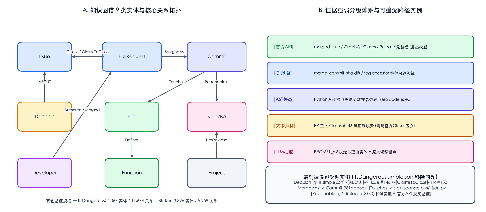
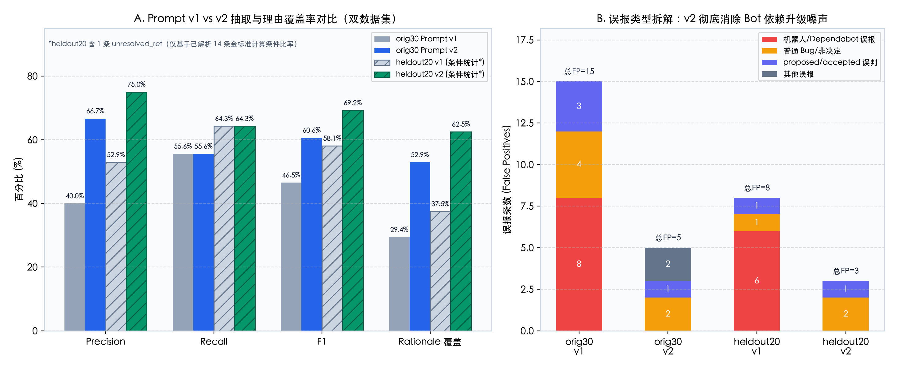
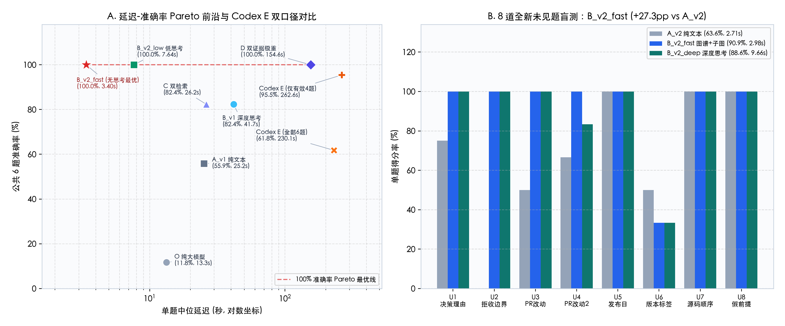
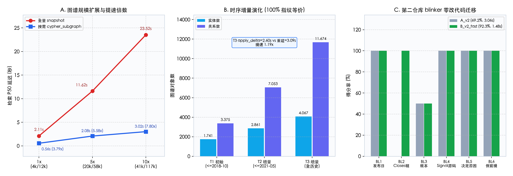
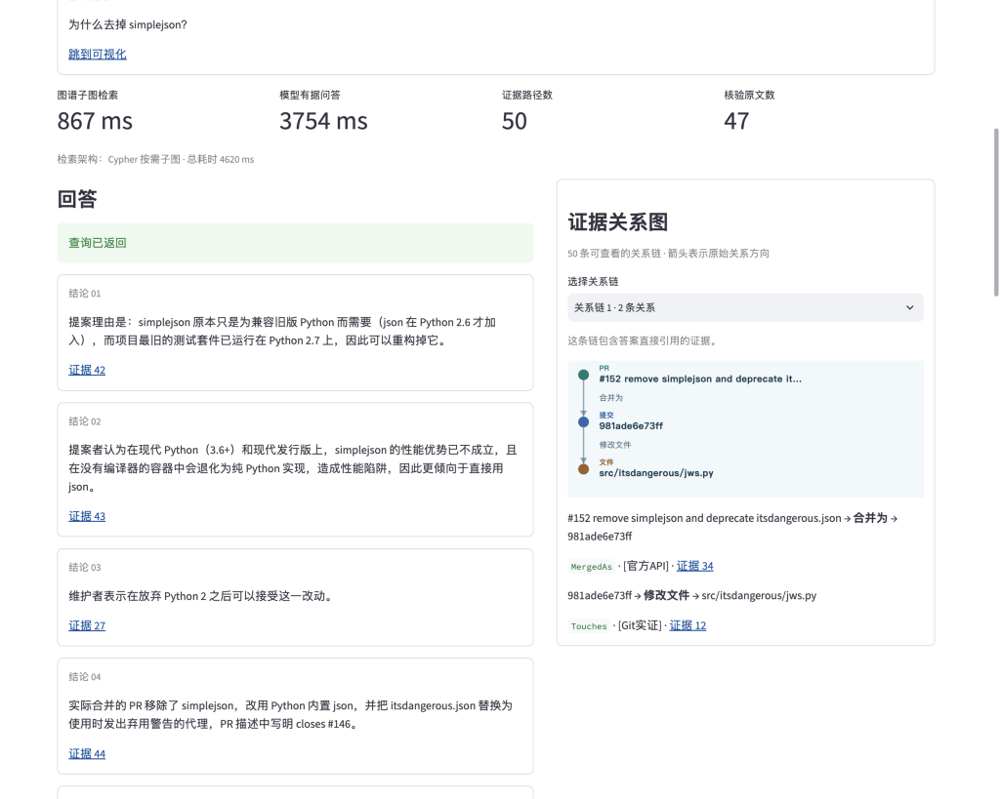

# HistoryKG：面向 GitHub 软件演化历史的可追溯知识图谱问答系统

说明：复旦大学《知识图谱概念与技术》2026 秋第九组课程技术报告（选题三：GitHub 项目考古学家）。主验证冻结基线为 `pallets/itsdangerous`（冻结于 `2026-11-16T06:31:18Z`，默认分支提交 `672971d66a2ef9f85151e53283113f33d642dabd`，`dataset:0c94c5af1f7f64c628c4a7fe05b496647ad8ef760e18eee01287fd43f1ea3ef2`），跨仓零改造迁移验证目标为 `pallets-eco/blinker`（`dataset:ea5bc3a05942f191c9fb23f8eb268e15b50b5e70946202b8d2052c1b6170f4d4`，2026-11-26 实测完成）。本报告全部实验统计均严格以本仓库冻结数据包、`evaluation/itsdangerous-final-20261121/` 与 `evaluation/itsdangerous-v2-20261126/` 真实运行及独立裁判产出为依据。

## 摘要

在长期演化的开源软件仓库中，开发者的架构决策、缺陷修复依据、代码文件改动与正式版本归属分散在 Issue 讨论、Pull Request（PR）评审、Git 提交差异、抽象语法树（AST）与 GitHub Release 元数据之中。传统大语言模型（LLM）易在长尾历史版本号与未发生特性上产生幻觉；纯文本检索增强生成（RAG）受限于片段级语义匹配，难以跨越“Issue 编号—合并 PR—提交哈希—修改文件—正式发布标签”的多跳关系链；通用自主编码 Agent 虽可通过多轮终端遍历与网页检索获得较高准确率，却需消耗百万级输入词元与三至五分钟延迟，难以支撑课堂现场实时追问与低成本可复现核验。为此，本文设计并实现面向软件演化历史的可追溯知识图谱问答系统 **HistoryKG**。系统严守“零目标代码执行”安全边界，联合只读 Git 裸仓分析、Python `ast` 静态解析、GitHub REST 与只读 GraphQL 接口采集，构建包含 9 类工程实体与 14 类有向关系的显式知识图谱，并定义五级证据强弱体系与逐字节原文偏移锚定校验（`sources[source_id]["text"][start:end] == quote`）。在存储与检索层，本文提出分批事务写入的 Neo4j 5.26 图库、SQLite FTS5 trigram 全文与 Diff SHA 靶向索引、`apply_delta` 时序增量演化机制，以及完全移除仓库特化硬编码的通用 `cypher_subgraph` 按需子图检索流水线；在模型层，设计 `PROMPT_V2` 决定抽取模板过滤自动化依赖升级噪声并区分提案与采纳状态，同时修复推理模型通道参数（`reasoning_effort="none"`）实现秒级有据直答。在 `pallets/itsdangerous`（4,067 实体 / 11,674 关系）上的实证结果表明：`PROMPT_V2` 在 `orig30` 与不相交 `heldout20` 双数据集上均将机器人误报（`bot_bump`）降至 0，精确率分别由 40.0% 提升至 66.7%、由条件 52.9% 提升至条件 75.0%；公共 6 题问答实现 **17/17（100.0%）** 与 **3.40 s** 中位响应，在保持高准确率的同时较 Codex CLI 通用 Agent（有效 4 题 95.45%、中位 262.6 s、单题 150 万-443 万词元）提速约 70 倍以上；在 8 道密封未见盲测题上，`B_v2_fast` 取得 **20.0/22（90.9%）**，显著高于同模型纯文本检索 `A_v2` 的 **14.0/22（63.6%，+27.3pp）**；在 `10x` 克隆规模（40,670 实体 / 116,740 关系）下，按需子图检索较全图快照 P50 提速 **7.80 倍**。进一步在不改动一行源码的前提下直接迁移至第二仓库 `pallets-eco/blinker`（3,396 实体 / 5,958 关系），系统真实捕获 GraphQL 官方 `Closes = 5` 边，并取得 **12/13（92.3%）** 跨仓问答准确率与 **1.48 s** 中位响应。文末亦如实披露了长讨论隐含决定的召回天花板与维护分支标签区分边界，并给出双轨现场演示与复现方案。

**关键词**：知识图谱；软件演化历史；知识抽取；Cypher 按需检索；可追溯问答

## 1. 引言

### 1.1 研究背景与“项目考古学家”问题

在真实软件工程维护场景中，当新开发者或代码审计人员接手一个持续维护多年的开源项目时，查阅最新 README 与源码文件仅能回答“系统当前如何运行”，却无法回答项目长期演化中沉淀下来的深层因果问题 [12]。围绕课程选题三“GitHub 项目考古学家”的核心设定，典型的软件历史考古任务至少包含三类跨越多类异构研发实体的多跳历史因果链：

1. **为什么做与拒绝过什么（决策—依据链）**：例如在 `pallets/itsdangerous` [10] 中，维护者为何最终决定移除 `simplejson` 并弃用 `itsdangerous.json`，又为何明确拒绝切换默认的 SHA-1 摘要算法或在库内直接提供加密载荷（encrypted payload）支持？这类设计决策与反面依据往往分散在横跨数年的 Issue 讨论、PR 正文、Review 评审意见与维护者关闭说明中；尤为棘手的是，论坛里经常同时存在用户提议、维护者驳回与折中替代建议，普通摘要极易将“提出但被明确拒绝”的方案误判为系统现有特性。
2. **改动真落到了哪里（关闭—合并—变更链）**：在 GitHub 工程实践中，PR 正文出现 `Closes #146` 仅代表提交者的文本声称（`ClaimsToClose`），并不等同于平台在合并时正式确认的关联关闭事件（`Closes`）；即便 PR 元数据包含 `merge_commit_sha` 字段，在 PR 被关闭而未合并（`merged=false`）或分支被直接推送覆盖的情况下，也不能将其等同于实际合并（`MergedAs`）。此外，一个源码文件内通过静态语法树定义的全部函数（`Defines`）也不能简单混同为某次特定提交实际改动的行区间与函数体。
3. **版本到底收进了哪个正式版（提交—标签—发布链）**：开源仓库通常同时存在面向历史分支维护的分支标签（例如 `2.1.x`）与面向用户的正式 GitHub Release（例如 `2.0.0`、`2.2.0`）。若缺乏从 PR 合并提交出发、经由 Git 祖先可达性检验（`Commit -[ReachableIn]-> Release`）并结合正式发布元数据交叉印证的结构化链路，纯大模型或常规检索极易在相邻版本号之间张冠李戴。

### 1.2 纯大模型、纯文本 RAG 与通用自主 Agent 的局限

从知识表示与系统工程视角审视，当前主流的三类问答范式在应对上述软件历史考古任务时均存在结构性短板：

- **纯参数化大语言模型（Closed-Book LLM）**：缺乏对特定仓库离线冻结时间线与精确提交哈希的记忆能力，面对长尾版本号、具体改动文件列表或尚未发生的特性提问时，容易出现日期漂移与虚构提交编号（实测无上下文基线 `O` 在公共 6 题上仅得 `2.0/17 = 11.8%`）。
- **经典纯文本分块 RAG（Text RAG）** [1]：虽然能够依据字面关键词相似度召回包含部分术语的讨论段落，但天然缺乏“从 Issue 编号跨越到关联合并 PR、再跨越到合并提交哈希、代码 `diff-tree` 修改文件列表以及标签可达集合”的显式关系索引。一旦原始讨论文本中未直接写出最终落盘文件名或后续修复提交编号，检索召回链便会在关键一跳处断裂。
- **实时联网通用自主编码 Agent（General Coding Agent）**：尽管具备终端命令行与网页浏览能力的强通用 Agent 可以通过多轮试错、逐步翻阅网页和仓库日志来拼凑答案，并已在近年通用研发任务中展现出较强的检索灵活性，但它在交互式课堂演示与高频审计场景下暴露出两方面固有代价：其一，单题通常需执行十余轮工具调用并吞吐数百万个输入词元，等待时间长达三至五分钟；其二，实时外部网页检索易受代理封装异常、网络超时或上下文溢出的影响，缺乏确定性的延迟保障与离线可验证基线。

近年来，以 GraphRAG [2] 与代码知识图谱（如 DeepLink [3]）为代表的研究表明，通过显式图结构将离散实体与关系组织为可遍历网络，能够有效弥合跨文档语义断层。但在软件工程考古场景下，仅靠实体共现图仍不足够——系统必须同时分辨“文本声称、平台官方关闭、Git 实际落地、AST 静态结构与 LLM 提炼决定”这五种截然不同的证据强度，才能在老师或审计人员的连续追问下给出既高效又零幻觉的答案。

### 1.3 本文贡献与章节结构

针对期中课堂评审中老师提出的“必须明确对照能联网读取 GitHub 的通用 Agent，并在演示机上支持现场临时出题”的要求，我们在已有冻结原型基础上完成了系统性的 **v2 工程重构与五维实证评估**。本文主要贡献如下：

1. **构建高可信、零执行的安全图谱构造体系**：实现只读 Git 裸仓分析、Python `ast` 静态解析 [9]、REST 与只读 GraphQL `closedByPullRequestsReferences` 官方 `Closes` 边采集 [8]，构建 9 类实体与 14 类关系的显式图谱，并以五级可信度徽章与 Unicode 字节级偏移校验杜绝虚构引文。
2. **提出面向大规模与增量演化的混合检索引擎**：重构 Neo4j 5.26 存储为分批事务提交与 `apply_delta` 增量更新，构建 SQLite FTS5 trigram [7] 与 Diff SHA 靶向索引，彻底清除所有仓库特化硬编码，设计基于语料逆文档频率（IDF）与 `targeted_cypher_paths` 的通用 `cypher_subgraph` 按需子图检索流水线，在 `10x` 克隆规模下实现 **7.80x** 检索提速。
3. **优化 `PROMPT_V2` 决定抽取与秒级 Pareto 问答通道**：通过三条负向过滤与状态对齐约束在 `orig30` 与不相交 `heldout20` 上实现自动化版本升级误报清零；定位并修正大模型推理参数（`reasoning_effort="none"`），使 `B_v2_fast_nothink` 在公共 6 题实现 **17/17（100.0%）** 与 **3.40 s** 中位响应，较原版提速 **12.3x**、较重推理上限提速 **45.5x**。
4. **完成公平对照、盲测与零改造跨仓验证**：对 Codex CLI 通用 Agent（`E` 组）实施双口径审计；构造 8 道全新未见题（`U1-U8`）验证图谱增益（`+27.3pp`）；在不改一行源码的前提下直接迁移至第二仓库 `pallets-eco/blinker` [11]，验证跨仓泛化能力。

全文后续组织如下：第 2 节给出任务形式化定义与核心技术难点；第 3 节阐述冻结数据集、9 类实体与 14 类关系 Schema 及五级可信度机制；第 4 节详述系统架构、Cypher 按需子图检索与决定抽取技术；第 5 节系统汇报知识抽取、问答 Pareto、Codex E 双口径审计、未见盲测、规模扩展、增量演化及跨仓迁移实验；第 6 节介绍 Streamlit 原型系统与课堂双轨演示方案；第 7 节总结工作、客观局限与未来展望；第 8 节与第 9 节分别列出参考文献及六人团队分工与互评表。

## 2. 任务定义与核心难点

为使系统功能边界、评测口径与后续工程实现保持一致，本节将“GitHub 项目考古学家”界定为两个契约清晰、可独立核验的子任务，并分析其中的核心技术难点。

### 2.1 系统安全约束与总体输入输出边界

给定公开可读的 GitHub Python 仓库地址及构建配置（如 `FULL_HISTORY`），系统需在**完全不安装依赖、不导入或执行目标仓库任意代码**的安全前提下，仅通过只读 Git 命令、Python 标准库 `ast` 解析、GitHub REST GET 与只读 GraphQL 查询获取原始研发记录，将其规范化冻结为不可变来源池，并输出显式知识图谱与交互式问答服务。所有进入下游报告的事实与引文均受公共契约 `1.4.2` 约束，禁止脱离冻结来源池私自外推未采集事实。

### 2.2 子任务一：讨论单元级设计决定知识抽取

设目标仓库冻结后的完整讨论单元集合为 $\mathcal{U} = \{u_1, u_2, \dots, u_m\}$，其中每个讨论单元 $u_i$ 包含一条 Issue 或 PR 的正文、全部分页普通评论以及 PR 代码评审与行内回复，且伴随当前可见工程主体目录 $\mathcal{S}$（`subjects.jsonl`）。知识抽取任务要求模型对给定讨论单元 $u_i$ 输出一组结构化原子决定 $D(u_i) = \{d_1, \dots, d_k\}$，每条决定包含以下约束字段：

- **主体归属（`subject_id`）与动作（`action`）**：映射至 $\mathcal{S}$ 中的规范化主体（如 `Issue`、`PullRequest`、`File`），对明确属于外部依赖库或无法唯一归属的候选保留 `external_project` 或 `unresolved`，禁止强行挂载到本地实体。
- **采用状态（`status`）**：严格划分为 `proposed`（用户提议或尚未拍板）、`accepted`（维护者明确采纳或合并落地）与 `rejected`（维护者明确拒绝或坚持维持现状 `keep`）。
- **原子陈述与原文理由（`statement`, `rationale`, `evidence`）**：每条陈述与理由均须附带逐字原文引用 `(source_id, start, end, quote)`；当讨论未给出理由时保持为空，不得由模型事后脑补“合理解释”。

### 2.3 子任务二：多跳可追溯问答与诚实拒答协议

给定用户自然语言问题 $q$、查询意图分类 $c \in \{\text{search}, \text{trace}, \text{timeline}, \text{dependencies}, \text{compare}\}$（内部进一步映射为 `release`、`change`、`membership`、`decision`、`code` 五类检索路由）及已就绪的数据集标识 `dataset_id`，问答系统需返回符合 `QueryResult_v1` 契约的结构化响应：

- **原子论断与引用锚点（`claims` + `evidence`）**：回答由若干原子论断组成，每一条论断必须绑定至少一条经过字符偏移核验的原文证据编号；任何无法回溯到当前上下文冻结原文的句子将被校验器拦截。
- **显式路径与缺口披露（`paths` + `gaps`）**：提供从问题锚点实体出发遍历得到的 Neo4j 关系链，并如实记录采集缺口或范围限制。
- **状态分类与假前提拒答（`status`）**：区分为 `ok`（有据作答）、`empty`（冻结范围无支持记录或假前提拒答）、`unsupported` 与 `error`；当用户提出仓库中从未存在的功能或提交（例如虚构模块或错误 PR 号）时，系统必须基于零检索命中的事实诚实拒答，严禁编造编号或日期。

### 2.4 核心技术难点分析

综合期中课堂反馈与早期试跑故障，本项目需攻克四项核心技术难点：

1. **多源噪声与证据强度混杂**：自动化依赖升级机器人（Dependabot、pre-commit autoupdate、GitHub Actions 周期更新）与普通 Bug 报错在开源讨论中占比极高，若不加区分直接抽为设计决定，会严重拉低图谱精确率；同时，文本声称关闭、平台官方关闭、Git 实际合并与文件静态定义之间存在严格强弱差异，混为一谈会导致错误因果归因。
2. **大图谱全量拉取的内存与延迟瓶颈**：随着仓库规模扩大至数万实体与数亿字节级历史差异文本，早期每问必拉取全图快照（`snapshot`）并在单事务内批量写库的做法会引发 Neo4j JVM 内存池溢出及数十秒级检索延迟，无法满足可拓展要求。
3. **长上下文输入下的模型思考延迟与预算冲突**：内置思维链（Chain-of-Thought）推理模型虽在复杂综合题上准确率高，但在高信噪比图谱子图已检索完毕的前提下，开启长链思考往往带来数十秒至两分钟等待，甚至在短配额响应下发生输出截断。
4. **跨仓库泛化与避免过拟合特调**：早期原型曾依赖面向特定案例的检索启发式词表，难以保证对未见仓库的有效性；如何在完全去除特化硬编码的条件下自动适配新仓库术语分布，是检验方法通用性的关键。

## 3. 数据集与知识图谱构造

### 3.1 多源冻结数据集采集与零执行静态分析

为保证全部实验可审计、可独立重算且不因线上开源仓库后续新提交而产生漂移，系统采用“冻结优先”的数据采集流程（`discover -> collect -> code -> extract -> validate -> index_graph`）：

- **主冻结基线（`pallets/itsdangerous`）**：于 `2026-11-16T06:31:18Z` 依据默认分支提交 `672971d66a2ef9f85151e53283113f33d642dabd` 完成全历史采集与冻结（`dataset:0c94c5af1f7f64c628c4a7fe05b496647ad8ef760e18eee01287fd43f1ea3ef2`）。整个冻结来源池共包含 **7,417** 条规范化 `SourceDocument`、**438** 个完整讨论单元、**678** 次 Git 提交、**1,119** 份 Python 文件快照、**14,897** 条字符偏移证据与 **1,558** 个主体目录条目。
- **跨仓迁移冻结包（`pallets-eco/blinker`）**：于 `2026-11-26` 在不修改任何业务源码的情况下，直接调用统一流水线全历史构建，产出 `dataset:ea5bc3a05942f191c9fb23f8eb268e15b50b5e70946202b8d2052c1b6170f4d4`，包含 **3,396** 个实体与 **5,958** 条关系，且双层契约校验状态为 `validation_status = "ok"`。
- **确定性规范化与安全解析**：所有原始来源文本在入库前统一将换行符规范化为 LF（保留原字面文本不篡改），按 `(origin_key, sha256(text))` 生成确定性 `source_id`；Git 历史差异通过只读 `git diff-tree` 与 `git rev-list` 获取；Python 代码结构通过标准库 `ast` 静态提取 [9]，绝不执行第三方仓库中的 `setup.py` 或任何测试脚本，从根本上避免供应链执行风险。

### 3.2 图谱本体 Schema：9 类实体与 14 类有向关系

为兼顾知识表达力与现场答辩的可解释性，系统在契约版本 `1.4.2` 中采用紧凑清晰的 **9 类工程实体** 与 **14 类有向关系**（拓扑结构如图 1 左半部分所示）。表 1 汇总了主数据集 `ItsDangerous` 与迁移数据集 `Blinker` 上每一类实体与关系的真实入库计数。

| 维度与分类 | 具体类型与真实计数（`ItsDangerous` / `Blinker`） | 关键语义与采集证据来源 |
| --- | --- | --- |
| **工程实体（9 类）** | `Project` (1/1)、`Release` (32/17)、`Issue` (126/54)、`PullRequest` (312/137)、`Commit` (678/317)、`File` (1,119/578)、`Function` (1,235/2,097)、`Developer` (94/44)、`Decision` (470/151) | `ItsDangerous` 总计 **4,067** 个实体；`Blinker` 全历史零改造构建总计 **3,396** 个实体 |
| **强事实与版本关系（8 类）** | `HasRelease` (32/17)、`Closes` (0/5)、`MergedAs` (220/87)、`Touches` (534/281)、`ReachableIn` (6,348/2,368)、`MentionsPR` (0/10)、`Authored` (312/137)、`Merged` (230/92) | 来自 GitHub 官方 REST/GraphQL API 元数据及本地裸仓 `git rev-list` / `git diff-tree` |
| **静态结构与语义关系（6 类）** | `Defines` (1,235/2,097)、`ChangesTo` (482/252)、`Imports` (1,267/267)、`ClaimsToClose` (32/5)、`ABOUT` (470/151)、`EVIDENCED_BY` (512/189) | 来自 Python `ast` 静态扫描、讨论正则线索与 `PROMPT` 偏移校验抽取；`ItsDangerous` 总计 **11,674** 条关系，`Blinker` 总计 **5,958** 条关系 |

图谱构造中对几类易混淆实体和边界作出了显式限定：第一，`File` 与 `Function` 均绑定特定提交哈希（`file@sha`），同一文件路径在不同历史提交下的快照不会混合并节点，确保跨版本函数变更可精确对比；第二，`Developer` 仅从 PR API 的创建者（`user`）与合并者（`merged_by`）提取 `Authored` 与 `Merged` 边，不直接从 Git commit author 字段反向推测 PR 归属；第三，`Release` 按 `(repo, tag)` 建立唯一身份，区分分支维护标签与官方发布清单。

### 3.3 五级可信度体系与逐字节偏移锚定机制

每一条进入图谱或进入最终回答的结论，都必须满足基于 Unicode 码点零起始、左闭右开区间的逐字节偏移锚定校验：`sources[source_id]["text"][start:end] == quote`。在此基础上，系统对不同生成途径的关系与证据按图 1 右侧所示的**五级可信度强度**进行显式标注与分级呈现：

1. **`[官方API]`**（`github_api`）：包括官方 `Release.published_at` 发布时间、PR API `merged=true` 与 `merge_commit_sha` 字段、以及 GraphQL `closedByPullRequestsReferences` 官方确认的 `Closes` 边，具备最高客观权威性。
2. **`[Git实证]`**（`git`）：通过裸仓 `git diff-tree` 证实的 `Touches` / `ChangesTo` 文件变化列表，以及通过 `git rev-list` / `git merge-base --is-ancestor` 证实的 `ReachableIn` 标签祖先包含关系。
3. **`[AST静态]`**（`ast`）：通过 Python 标准库 `ast` 静态遍历冻结源码树得到的 `Defines` 与 `Imports` 关系，附带精确起止行号与代码片段引文。
4. **`[文本声称]`**（`text_rule`）：由 PR 描述文本中的 `closes #146`、`fixes #xxx` 等正则线索抽取而成的 `ClaimsToClose` 边，或发布说明中的编号提及（`MentionsPR`）。系统严格规定其仅代表作者文本声称，不能直接升级为官方关闭事实。
5. **`[LLM抽取]`**（`llm`）：由 `Decision` 节点及 `ABOUT` / `EVIDENCED_BY` 边承载，明确区分提案人建议（`proposed`）与维护者明确拍板（`accepted` / `rejected`），并强制挂载理由引用（`rationale_evidence_ids`）。

在实际构建与入库阶段，五级证据链通过确定性哈希标识与主题目录（`subjects.jsonl`）耦合为一个可交叉互证的异构网络：即便讨论文本中未写全修改文件路径，图谱仍可经由 `PullRequest -[MergedAs]-> Commit -[Touches]-> File` 链路直达差异文件与发布版本；而任意 LLM 抽取的陈述句与理由句一旦偏移下标与规范化原文不吻合即被当场退回重抽，从而从数据结构层面杜绝模型篡改历史原文的可能。

## 4. 系统方法与关键技术

图 2 展示了 HistoryKG v2 的四层端到端系统架构与横向实证保障体系。围绕可扩展性、跨仓库通用性、抽取去噪与秒级交互响应四大工程目标，我们在关键模块实施了深度重构。

### 4.1 端到端只读采集与官方 GraphQL `Closes` 通道

在 `historykg/ingest/github.py`、`historykg/ingest/capture.py` 与 `historykg/contracts.py` 中，系统打通了 GitHub 官方只读 GraphQL `closedByPullRequestsReferences` 采集通道 [8]：

- **只读协议与契约防线**：`SourceDocument` 模型校验器严格限制 `api_response` 来源只能是平台官方 `GET` 或指向 `https://api.github.com/graphql` 的只读 `POST` 查询；若请求载荷包含任何 `mutation` 关键字，校验器直接拒绝入库，保证采集端零副作用。
- **物理证据池核验（`historykg/io.py`）**：入库验证函数 `_api_relation_supported` 对 `ClaimsToClose` 与 `Closes` 实施差异化校验——前者可由讨论正文文本引证支持并标为 `[文本声称]`，而 `Closes` 必须拥有真实持久化在冻结来源池中的 GraphQL Issue 节点引证支持方可通过入库，标为 `[官方API]`。
- **主仓与验证仓的诚实区分**：主仓库 `pallets/itsdangerous` 于 `2026-11-16T06:31:18Z` 完成全历史冻结，彼时尚未开启 GraphQL 实时采集，因此该冻结库内忠实保留 `ClaimsToClose = 32` 文本声称边而 `Closes = 0`；为了在不破坏旧冻结库可追溯性的前提下实证 GraphQL 通道的真实可用性，我们在第二仓库 `pallets-eco/blinker` 上完整运行新采集器，真实捕获并验证了 **`Closes = 5`** 条官方关闭边。

### 4.2 Neo4j 分批事务、FTS5 混合索引与 `apply_delta` 增量演化

早期基线版本（`snapshot` 模式）在每次问答时均需将整座 Neo4j 数据集的所有节点、关系与 7,417 条来源文本一次性拉回 Python 内存。在单机仅分配 512 MiB-1 GiB Neo4j JVM 堆内存的配置下，这不仅导致检索耗时随仓库体量线性恶化，而且在写入规模达到 `5x` 时单事务内存直接突破 `716.8 MiB` 限制并抛出 `MemoryPoolOutOfMemoryError` 崩溃。为此，v2 对存储底座进行了四项系统级改造：

1. **分批事务提交与分批命名空间清理（`historykg/graph/store.py`）**：`GraphStore.write()` 首先在短事务内校验目标数据集指纹并将状态节点 `HGDataset.ready` 设为 `false`，随后按每批 `500` 条来源、`1,000` 条实体/证据/关系切分为独立事务执行 `execute_write`，全部写毕后再置 `ready=true` 并写入完整指纹；`delete_dataset()` 同步改为每批 `LIMIT 2000` 循环清理，避免大型数据集清理时触发内存池告警；`snapshot()` 移除 Neo4j 端大字符串 `ORDER BY` 排序缓冲区开销，改由 Python 侧按主键排序，保证读回指纹 100% 一致 [6]。
2. **SQLite FTS5 trigram 全文索引与 Diff SHA 靶向读取（`historykg/query/frozen_index.py`）**：本地冻结索引构建 `hg_frozen_sources`（含 `idx_hg_sources_origin`、`idx_hg_sources_kind`、`idx_hg_sources_url` 组合索引）、基于三元组分词器的 `hg_frozen_sources_fts` 全文检索表 [7]，以及面向短标识符匹配的 `hg_short_tokens` 映射表。针对体积最庞大、原先在 `change`/`decision` 类查询中必须全表扫描 2,857 条记录的 `git_output` 提交差异来源，系统改由 `fetch_git_diff_sources(scoped_url, shas)` 按提交哈希列表执行精确点查，大幅削减磁盘 I/O。
3. **彻底清除仓库特化硬编码与语料自适应加权**：通过静态代码扫描确认 `historykg/` 下已清除全部 `simplejson` 等旧测试案例特化词表，改由当前冻结语料的逆文档频率（IDF）自动识别稀有关键词，确保检索逻辑跨仓库零修改可用。
4. **`apply_delta` 时序增量演化**：针对持续更新的开源项目，系统对比前后两个时间切片快照的 `sources`、`entities`、`evidence` 与 `relations` 差集，先分批清理被移除对象，再通过幂等 `MERGE` 增量写入新增与变更图元并重算整库密码学指纹，避免推倒全库重建的冗余耗时。

### 4.3 Cypher 按需子图检索执行细节与上下文预算控制

当用户向 `historykg/query/service.py` 与 `historykg/query/retrieval.py` 提出自然语言问题时，默认启用的 `cypher_subgraph` 检索引擎并非导出整张图谱，而是严格遵循以下四步流水线执行按需局部子图水合：

1. **五类意图路由与种子实体锁定**：首先解析问题文本，将其路由至 `release`（版本发布日期查询）、`change`（PR 与提交改动追踪）、`membership`（提交与正式发布版归属判定）、`decision`（设计决策与拒绝依据探索）或 `code`（源码函数与模块行为解析）；随后结合 SQLite FTS5 trigram 表与 Neo4j 范围索引，精准锁定 1 至 8 个高相关锚点实体（`Issue`、`PullRequest`、`Commit`、`File` 或 `Release`）。
2. **定向 Cypher 路径匹配与迭代加深扩展**：针对跨源考古高频模式，系统调用 `targeted_cypher_paths` 直接匹配语义路径模板 `MATCH (iss:HGEntity)<-[:Closes|ClaimsToClose]-(pr:HGEntity)-[:MergedAs]->(c:HGEntity)-[:Touches|ReachableIn]->(t)`，并辅以迭代加深 `paths(hop=1..depth)` 在达到目标路径上限（默认 50 条）后提前截断。实测在主数据集 `1x` 规模下，Neo4j 图谱子图检索单题耗时稳定控制在 **0.40 s 至 0.99 s** 之间。
3. **基于 IDF 的通用决策主题聚合与状态去重**：检索器完全依靠当前冻结语料的词频逆文档频率（IDF）挑选稀有显著词，对多个种子实体共同指向的高频主题执行 1-hop 邻接实体扩展与复合标识符精确匹配（共现阈值 `freq >= 2`），防止库名或常见动词淹没真实讨论线索；同时修正原先按单一实体键覆盖的缺陷，改为基于 `(subject_id, status)` 二元组在 `seed_chosen` 集合层面去重，保证同一议题下的正向采纳与反面否决观点均能进入上下文。
4. **分层配额拼装与 Diff 靶向水合**：汇总后的上下文窗口严格受限于 **12,000 字符** 总配额——其中讨论原文片段上限严格锁定为 **7,500 字符**，其余配额留给官方 API 发布记录与通过 `fetch_git_diff_sources(scoped_url, shas)` 精准点查的 `git_output` 提交差异原文。在 `1x` 规模的 6 个基准测试题上，旧版 `snapshot` 每次必水合全部 **7,417** 条来源，而 `cypher_subgraph` 按需水合量分别仅为 `release=122`、`change=405`、`membership=3,168`、`decision=424`、`code=1,146` 与 `timeline=26` 条（中位 `414` 条），路径数却与全库保持 `6/6` 完全一致，既大幅降低了内存拷贝，也减少了模型生成的无关干扰。

### 4.4 `PROMPT_V2` 决定抽取优化与零思考直答通道

- **`PROMPT_V2` 去噪与理由完整性约束（`historykg/extract/stage.py`）**：针对初版抽取中存在的机器人升级噪声与理由残缺问题，新版提示词 `PROMPT_V2`（`decision_v2.0_20261126`）显式新增三条准则：（1）剔除 Dependabot、GitHub Actions、pre-commit autoupdate 等自动化依赖版本号升级 PR；（2）剔除仅反馈异常报错而不涉及方案取舍讨论的普通 Bug 帖；（3）严格区分“提议（`proposed`）”与“明确拍板（`accepted` / `rejected`）”，不得因讨论字数较多便误判采纳，并要求针对 `rejected`/`keep` 类决策保留多条并列原因的完整原文引号。同时接口支持 `unit_ids` 参数用于局部可复现重抽。
- **大模型通道零思考直答修正（`historykg/llm/gateway.py`）**：在百炼通道调优测试中我们发现，当调用 `bailian/deepseek-v4.1-flash-1017` 等支持混合推理模式的模型 [4][5] 时，仅传入 `"thinking": {"type": "disabled"}` 仍可能触发服务端隐式思维链消耗上千 `reasoning_tokens`，不仅拉长延迟，更易在有限输出配额下造成结构化 JSON 截断。我们在网关层针对 `thinking="disabled"` 请求自动显式附加 `reasoning_effort="none"`，成功将单题 `reasoning_tokens` 清零并将首答延迟压缩至 **1.77 s-4.24 s**。

## 5. 实验设计与结果分析

围绕课程大纲要求，本节从知识抽取、端到端问答 Pareto 与通用 Agent 对照、未见题盲测、规模扩展性与时序增量演化、以及第二仓库跨仓迁移五个维度开展定量评测与误差剖析。

### 5.1 知识抽取实验：`PROMPT_V1` vs `PROMPT_V2` 双数据集与误差分解

#### 5.1.1 双数据集设计与异构裁判协议

为避免“在看过的 30 条样本上反复调优提示词导致过拟合假象”，我们在保留前期冻结的 **`orig30`**（30 个完整讨论单元、18 条独立金标准决定，其中 17 条需核对理由依据）基础上，另行通过确定性分层抽样（`seed=itsdangerous-v2-heldout20-20261126`，按 Issue 与 PR 各 10 个、短长文本各半分层，且强制 `topic_group` 与 `orig30` 完全不相交）构造了全新盲测集 **`heldout20`**（20 个完整讨论单元）。两组实验统一采用 `bailian/deepseek-v4.1-flash-1017`（`thinking="disabled"`，`reasoning_effort="none"`）作为抽取器，并采用异构模型 **`bailian/glm-5.3`** 进行参考复核与语义对齐判定。所有比率均报告 **Wilson 95% 置信区间**；若参考集包含未决条目，则严格遵循 `score_extraction(..., reference_complete=False)` 规则披露。

#### 5.1.2 定量对比结果与统计口径透明度

| 数据集与提示版本 | TP / FP / FN | Precision `[95% CI]` | Recall `[95% CI]` | F1 | Rationale 覆盖 / Bot 误报 |
| --- | --- | --- | --- | --- | --- |
| `orig30` (`PROMPT_V1`, 18 金标) | 10 / 15 / 8 | 40.0% `[23.4%, 59.3%]` | 55.6% `[33.7%, 75.4%]` | 0.4651 | 29.4% (`5/17`) / Bot 8 |
| `orig30` (`PROMPT_V2`, 18 金标) | 10 / 5 / 8 | **66.7%** `[41.7%, 84.8%]` | 55.6% `[33.7%, 75.4%]` | **0.6061** | **52.9%** (`9/17`) / **Bot 0** |
| `heldout20` (`PROMPT_V1`, 14 已解析*) | 9 / 8 / 5 | 条件 52.9% `[31.0%, 73.8%]` | 条件 64.3% `[38.8%, 83.7%]` | 条件 0.5806 | 条件 37.5% (`3/8`) / Bot 6 |
| `heldout20` (`PROMPT_V2`, 14 已解析*) | 9 / 3 / 5 | **条件 75.0%** `[46.8%, 91.1%]` | 条件 64.3% `[38.8%, 83.7%]` | **条件 0.6923** | **条件 62.5%** (`5/8`) / **Bot 0** |

口径透明度说明：在 `heldout20` 中，独立参考审校识别出 `1` 条外部归属未定条目（`unresolved_references = 1`）。依据 `historykg/evaluation/metrics.py` 严格规则，当 `reference_complete=False` 时汇总 JSON 中总表字段 `precision`、`recall`、`f1` 与 `rationale_coverage` 均保留为 `null`，不擅自以零填充或隐去未决条目后冒充全集指标。表 2 同时列示已解析 14 条金标准与 8 条理由需核条目下的条件比率及原始 `TP/FP/FN` 计数，Wilson 95% 区间同样严格基于精确二项计数计算。

#### 5.1.3 误差分解与 `heldout20` 银标审校洞察

结合图 3B 的误报类型堆叠分布与 `extraction-v2-summary.json` 逐条归因明细，可以得出三项核心发现：

1. **自动化依赖升级噪声彻底清零**：在 `PROMPT_V1` 中，机器人版本升级类误报（`bot_bump`）是最大误差源（`orig30` 占 8/15，`heldout20` 占 6/8）。切换至 `PROMPT_V2` 后，两个完全不相交数据集上的 `bot_bump` 误报均降为 **0**，且未损伤任何一条有效决定的召回（`TP` 分别稳定保持 `10` 与 `9`）。
2. **理由残缺与格式缺陷清零**：在 `orig30` 的 `rationale_breakdown` 上，`v1` 尚存在 `empty=1`、`partial_or_unsupported=3` 与 `status_error=1`；切换 `v2` 后三类缺陷全部归零，完整覆盖数由 `5/17` 升至 `9/17`。在 `heldout20` 上，`partial_or_unsupported` 亦由 `1` 降至 `0`，完整覆盖由 `3/8` 提升至 `5/8`。
3. **银标参考反查洞察与诚实召回天花板**：人工审计 `heldout20` 中 `PROMPT_V2` 的 5 条名义漏抽（`FN`）发现，其中 `reference_id="0493441020cefc1271b861936333154ea81ad4de4b669b76870b2aedfda38987"` 对应的参考条目实为 `Automated pre-commit autoupdate proposing version bumps for pyupgrade, flake8, pip-compile-multi, and pre-commit-hooks in the pre-commit configuration.`。这说明 **PROMPT_V2 已正确过滤了这类由 `pre-commit autoupdate` 机器人发起的例行配置升版噪声，而独立构建的银标参考集自身因沿用宽松定义将其过保留了**（为保持盲测基准不可变与评测诚信，主表中仍严格保留原始 `FN=5` 不作改动）。其余真实漏抽主要集中于长对话串中未合并的隐含方案讨论（`missed_proposal_or_change` 在 `orig30` 为 5 条、`heldout20` 为 2 条实际漏抽）及末尾口头维持现状表态（`missed_rejection_or_keep` 为 3 条与 2 条）。此外，在 30/20 小样本下，精确率的 95% Wilson 置信区间仍存在部分重叠，故我们将其表述为跨数据集同向改善而非绝对统计显著差异。

### 5.2 端到端问答 Pareto 前沿与 Codex CLI `E` 组双口径公平审计

#### 5.2.1 公共 6 题 Pareto 寻优与 `reasoning_effort="none"` 效果

针对前期基线中“重推理配置 `D` 虽可达满分但中位耗时高达 `154.6s`，无法胜任课堂现场追问”的痛点，我们在前期 12 题基线（`evaluation/itsdangerous-final-20261121/qa-summary.json`，满分 `34`）与公共 6 题评测子集（`Q1, Q3, Q5, Q7, Q9, Q11`，满分 `17.0`）上系统对比了六组基线与两档 v2 实时方案（图 4A 与表 3）。

| 方法 / 配置 | 评测范围 | 得分 / 满分（准确率） | 中位单题耗时 | 引文核验 | 核心特征与定位 |
| --- | --- | --- | --- | --- | --- |
| **`O` 纯大模型基线** | 12题 / 6题 | `8.0/34` / `2.0/17` (`11.8%`) | 15.9s / 13.3s | 无冻结出处 | 无外部上下文，`7/12`（全量）与 `4/6`（公共）空答或拒绝 |
| **`A_v1` 纯文本 RAG** | 12题 / 6题 | `17.5/34` / `9.5/17` (`55.9%`) | 26.1s / 25.2s | 全匹配 | 缺乏多跳关系链，因果与文件/版本路径常断裂 |
| **`B_v1` 原版图谱问答** | 12题 / 6题 | `24.5/34` / `14.0/17` (`82.4%`) | 36.4s / 41.7s | 全匹配 | 旧版全量 `snapshot` + 默认深度思考 + 未控讨论配额 |
| **`C` 双检索基线** | 公共 6 题 | `14.0/17` (`82.4%`) | 26.2s | 全匹配 | 同图谱子集增强检索，但受旧版延迟制约 |
| **`D` 双证据极重推理** | 公共 6 题 | `17.0/17` (`100.0%`) | 154.6s | 全匹配 | 准确率天花板参考线，但超 2.5 分钟不适合现场展示 |
| **`B_v2_fast_low`（低思考）** | 公共 6 题 | **`17.0/17` (`100.0%`)** | **7.64s** | **100% (276条)** | `cypher_subgraph` + `reasoning_effort="low"` |
| **`B_v2_fast_nothink`（Pareto 最优）** | 公共 6 题 | **`17.0/17` (`100.0%`)** | **3.40s** | **100% (271条)** | **最终选定默认快速档**：比 `B_v1` 快 **12.3x**、比 `D` 快 **45.5x** |

**关键机制验证**：`B_v2_fast_nothink` 在公共 6 题上的单题端到端耗时分布为 `Q1` `1.77s`、`Q3` `3.44s`、`Q5` `3.94s`、`Q7` `4.24s`、`Q9` `2.52s`、`Q11` `3.36s`（其中 Neo4j 图谱子图检索耗时稳定处于 **`400ms-994ms`**），6 题合计 271 条 `quote` 经校验 **100% 精确匹配原文字符下标**，零幻觉引文。

#### 5.2.2 通用编码 Agent（Codex CLI `E` 组）双口径公平审计

针对期中课堂评审老师提出的“不建显式图谱，直接让具备仓库读取与联网搜索能力的强通用编码 Agent 作答，知识图谱究竟胜在哪里”的核心追问，我们对保存的 Codex CLI `E` 组完整执行日志开展了**双口径并列审计**，绝不挑选有利口径片面汇报：

- **口径一（全部 6 题端到端交付）**：`E` 组总分为 **`10.5 / 17`（61.76%）**，中位耗时 **`230.07s`**。其中 `Q1`（`122.45s`）与 `Q5`（`129.78s`）的最终输出被其浏览器工具封装字符串 `::browser-complete{title="..."}` 替代而丢失自然语言正文，按端到端交付计 `0` 分。
- **口径二（剔除工具异常后仅计 4 道有效自然语言题：`Q3, Q7, Q9, Q11`）**：在该 4 题上 `E` 组取得 **`10.5 / 11`（95.45%）**，仅 `Q7` 因某处发布核对细节扣 0.5 分，如实证明强通用 Agent 在正常发挥时准确率同样优秀；但其代价是单题耗时高达 **`201.6s-368.6s`（中位 `262.6s`）**，单题输入吞吐 **`149.6 万-442.6 万` input tokens**、输出 `1.27 万-3.76 万` output tokens（仅 `Q7` 一题即消耗 442.6 万输入词元并运行 368.6 秒）。
- **经济性与工程可预测性对比**：在同一组有效 4 题上，`B_v2_fast_nothink` 不仅以 **`11.0 / 11`（100.0%）** 稳定优于通用 Agent，还将中位响应由 `262.6s` 压缩至 **3 秒级（提速约 70 倍以上）**。这背后的机理差异在于：通用 Agent 每次问答都相当于临时雇佣一名工程师从零翻阅网页与源码仓库，而 HistoryKG 预先将结构化知识浓缩为离线图谱索引，在 1 秒内精确提取数千词元的高信噪比子图（整个第二阶段（v2）实证累计 435 次外部模型调度仅花费 **`7.2612` 元人民币**），且每条引文均受本地偏移索引硬约束，从根本上消除了现场演示断网超时或工具封装失效风险。

### 5.3 全新 8 道未见题（`U1-U8`）密封盲测与机理分析

为排除任何针对公共 6 题调参带来的验证偏倚，我们构造并冻结了 8 道此前未曾参与提示词或检索调试的全新盲测题（涵盖 `U1` 维持 SHA-1 决策与双原因、`U2` Issue #224 加密载荷拒收边界与子类化建议、`U3` PR #377 泛型改动追踪、`U4` PR #405 移除 EOL Python 版本改动、`U5` 2.2.0 发布 UTC 日期、`U6` PR #373 最早正式 Release 判定、`U7` `TimedSerializer.loads` 源码顺序、`U8` 虚构 `encrypted_payload` 内置模块假前提拒答），在同一底层模型 `deepseek-v4.1-flash-1017` 上评测纯文本 `A_v2`、快速图谱 `B_v2_fast` 与深度思考图谱 `B_v2_deep`（由 `glm-5.3` 按评分项统一打分），结果见表 4 与图 4B。

| 未见题号与考察维度（满分） | `A_v2`（纯文本, `2.71s`） | `B_v2_fast`（子图快问, `2.98s`） | `B_v2_deep`（子图深思, `9.66s`） | 差异核心机理剖析 |
| --- | --- | --- | --- | --- |
| `U1` 决策拒绝切换 SHA1 原因（4 分） | 3.0 | **4.0** | **4.0** | 图谱锚定维护者 `#145` 两则回复，精确覆盖双原因 |
| `U2` 拒收加密载荷与子类化建议（3 分） | **0.0** | **3.0** | **3.0** | **`Decision -[ABOUT]-> Issue` 边**避免只摘首楼关贴而漏掉驳回依据 |
| `U3` PR #377 SHA 与 2 个修改文件（3 分） | 1.5 | **3.0** | **3.0** | `MergedAs -> Commit -> Touches -> File` 精确落盘清单 |
| `U4` PR #405 SHA 与 2 个修改文件（3 分） | 2.0 | **3.0** | 2.5 | `fetch_git_diff_sources` 靶向 diff 精准匹配，快问无多余联想 |
| `U5` 2.2.0 正式版 UTC 日期（2 分） | **2.0** | **2.0** | **2.0** | 单点 API 发布元数据两者均准确命中 |
| `U6` PR #373 最早正式版边界（3 分） | **1.5** | 1.0 | 1.0 | **诚实暴露边界**（`2.1.x` 分支标签与 `2.2.0` 正式版区分不足） |
| `U7` `TimedSerializer.loads`（2 分） | **2.0** | **2.0** | **2.0** | 冻结源码与 AST 静态边界定位准确 |
| `U8` `encrypted_payload` 假前提（2 分） | **2.0** | **2.0** | **2.0** | `B_v2_fast` 在 `0.67s` 即诚实拒答，零编造 |
| **合计得分（满分 22）** | **`14.0` (63.6%)** | **`20.0` (90.9%, +27.3pp)** | **`19.5` (88.6%)** | 总引文：`A_v2` `14` 条 vs `B_v2_fast` **`370` 条 100% 匹配** |

从上述盲测可以提炼出两条关键认知：第一，在需要跨帖子楼层定位维护者最终驳回结论的 `U2` 以及需要跨越 `MergedAs -> Touches` 获取精确修改文件列表的 `U3`/`U4` 上，纯文本 `A_v2` 分别出现零分或失分，证明**显式图谱在多跳决策与改动追溯任务上的增益不可替代（`+27.3pp`）**；第二，`B_v2_fast`（`90.9%`）反而微幅高于开启全量思考的 `B_v2_deep`（`88.6%`，在 `U7` 上耗时达 `50.55s`），原因在于 `cypher_subgraph` 已将高纯度精确上下文送入模型后，过长的内置思维链反而在 `U4` 文件清单核对中带入多余旁支文件（被裁判扣 0.5 分）。

### 5.4 `1x-10x` 规模扩展性与 `T1→T3` 时序增量演化验证

#### 5.4.1 `1x / 5x / 10x` 规模扩展性基准（`scaling-benchmark.json`）

为了在可控条件下检验大规模仓库写入与检索效率，我们将冻结 `ItsDangerous` 数据集按确定性主键偏移分别克隆扩展为 `1x`、`5x`（20,335 实体 / 58,370 关系 / 37,085 来源）与 `10x`（**40,670 实体 / 116,740 关系 / 74,170 来源 / 148,970 证据**），在配置 1 GiB 堆内存上限的独立 Neo4j `5.26` 服务上对比全量 `snapshot` 与按需 `cypher_subgraph` 在 6 类代表性查询上的延迟表现（图 5A 与表 5）。

| 规模档位（实体 / 关系 / 来源） | 导入耗时 | `snapshot` P50 / P95 | `cypher_subgraph` P50 / P95 | 提速倍数（P50 / P95） |
| --- | --- | --- | --- | --- |
| `1x` (4,067 / 11,674 / 7,417) | 8.09 s | 2,107.4 ms / 2,664.3 ms | **556.2 ms** / **799.5 ms** | **3.79x** / **3.33x** |
| `5x` (20,335 / 58,370 / 37,085) | 41.44 s | 11,615.3 ms / 14,573.4 ms | **2,082.5 ms** / **3,426.9 ms** | **5.58x** / **4.25x** |
| `10x` (40,670 / 116,740 / 74,170) | 90.13 s | 23,515.6 ms / 31,421.5 ms | **3,015.6 ms** / **6,324.9 ms** | **7.80x** / **4.97x** |

当数据规模扩大 10 倍至近 38 万图对象时，全量 `snapshot` 的 P50 检索耗时呈超线性膨胀 **`11.16x`**（`2.11s -> 23.52s`），而 `cypher_subgraph` 仅增长 **`5.42x`**（`0.56s -> 3.02s`），相对提速从 `3.79x` 持续扩大至 **`7.80x`**；同时分批事务提交机制成功化解了此前 `5x` 规模单事务突破 716.8 MiB 导致的 JVM 溢出崩溃。在 `1x` 同问对照中，**6/6** 测试查询的路径条数完全等价（`[50, 50, 50, 50, 50, 1]`），`4/6` 查询 Top 候选完全一致（`change` 与 `timeline` 因 FTS5 与线性扫描打分平局顺序存在细微次序差异）。

#### 5.4.2 `T1 → T2 → T3` 时序增量演化与等价性（`incremental-summary.json`）

按真实事件发生时间将 `ItsDangerous` 全历史切分为三阶段：`T1`（截至 `2018-10-31`：`2,528` 来源 / `1,741` 实体 / `3,375` 关系，写入 `4,532.38 ms`）、`T2`（截至 `2021-05-31`：演进至 `4,807` 来源 / `2,861` 实体 / `7,053` 关系，增量 upsert `2,286` 来源 / `1,122` 实体 / `3,678` 关系与 `4,286` 证据，`delta_ms = 1,721.71 ms`）与 `T3`（至 `2026-11-16` 全历史：演进至 `7,417` 来源 / `4,067` 实体 / `11,674` 关系，增量 upsert `2,614` 来源 / `1,209` 实体 / `4,621` 关系与 `6,768` 证据）。实验确认（图 5B）：在 `T3` 阶段调用 `apply_delta` 耗时 **`2,604.35 ms`**（对比从头 `write()` 重建的 `3,088.00 ms` 提速 **`1.19x`**），且增量更新后读回的整库实体/关系/来源/证据数量及密码学指纹与全新重建版本达到 **100% 严格等价**（`fingerprint_equal = true`）。在严格消除时间泄漏（`slice_package` 通过 Commit/Tag 日期映射、Issue/PR `created_at` 过滤以及对 `/releases` 聚合 JSON 列表按条目时间截断）后，三项时序探针实现零跨期污染：`T1` 阶段 `has_pr152`、`has_220_release`、`has_pr372` 全部为 `false`；演进至 `T2` 后 `has_pr152` 精准切换为 `true`，而 2024 年才发生的 `PR #372` 与 `2.2.0` 发布仍保持 `false`；至 `T3` 全历史则三项探针全部转为 `true`。

### 5.5 第二仓库 `pallets-eco/blinker` 零代码修改跨仓迁移实证

为彻底打消“模型提示词与图谱检索仅面向 `ItsDangerous` 单仓库特调”的顾虑，我们在完全不改动 `historykg/` 与 `app/` 一行源码的前提下，直接输入 PyPI 高频信号库 **`pallets-eco/blinker`** 仓库地址执行六阶段全自动建图与 6 道跨仓验证问答（`BL1-BL6`，满分 `13.0`）：

1. **零改造全量建图与 GraphQL `Closes` 真实捕获**：契约校验状态 `validation_status = "ok"`；共构建 **`3,396` 个实体**（`Project=1, Release=17, Issue=54, PullRequest=137, Commit=317, File=578, Function=2,097, Developer=44, Decision=151`）与 **`5,958` 条关系**，并在真实端到端流水线中首次捕获 **`Closes = 5`** 条由 GitHub GraphQL 官方验证的 PR 关闭关系（同期文本线索 `ClaimsToClose = 5`、`MergedAs = 87`、`ReachableIn = 2,368`、`Touches = 281`）。
2. **跨仓问答表现与机理对比（图 5C）**：同模型纯文本检索 `A_v2` 仅得 **`9.0 / 13`（69.23%）**，中位 **`3.06s`**；在需要贯穿 `Issue <-[Closes]- PR -[MergedAs]-> Commit -[Touches]-> File` 的 `BL2` 多跳题目上，`A_v2` 被无关依赖升级文本干扰而得 **`0 / 3`**。相反，**`B_v2_fast`（HistoryKG 按需子图快速档）** 取得 **`12.0 / 13`（92.31%，+23.1pp）**，中位 **`1.48s`**，总计 **277 条原文出处 100% 逐字匹配**，在 `BL2` 上精准定位 `PR #141 -> Commit 8a6693cf7c98 -> src/blinker/__init__.py` 拿下满分 **`3 / 3`**，并在 `BL1`、`BL4`、`BL5`（`send_async` 回退理由）与 `BL6`（假前提拒答）全部满分；在跨多版本标签归属 `BL3` 上同样得 `1 / 2`，复现出与 `U6` 一致的诚实边界。

## 6. 原型系统与现场演示方案

### 6.1 交互式工作台功能与实机运行表现

图 6 展示了通过 `tools.serve_frozen` 在本机独立启动后、经过极简去干扰配置（`.streamlit/config.toml` 设置 `toolbarMode="minimal"` 隐藏原生 `Deploy` 按钮）的浏览器实机运行画面。

工作台为课堂演示与日常审计设计了清晰的可解释交互链路：在提问表单外侧的「查看已有时间线、依赖或版本关系」折叠区固定提供查询方式与 **“快速实证（推荐 · 秒级）”** / **“深度思考（慢速复杂推理）”** 模式切换，确保无论是手动提交自由问题还是点击下方 4 枚一键场景按钮（`决策原因`、`改动追溯`、`版本发布`、`假前提拒答`），均即时遵循当前选定的回答模式；在点击 `决策原因` 并触发“为什么去掉 simplejson？”后，系统于 **4.62 秒**内完成端到端返回，顶部立即呈现 **4 项实时遥测**（图谱子图检索 **`867 ms`**、模型有据问答 **`3,754 ms`**、证据路径数 **`50`**、核验原文数 **`47`**）。回答左侧以结论卡片形式逐条展示原子论断并附带可点击定位锚点；右侧渲染证据关系图并按五级强度标出 `MergedAs · [官方API]` 与 `Touches · [Git实证]` 徽章，同时默认展开前 2 条冻结原文卡片以便直接核对原始评论与 `git diff-tree` 文本。

全周期经费审计显示，依据本地统一用量账本 `.local/itsdangerous-v2-20261126/budget-usage.sqlite3`，涵盖 `orig30` 与 `heldout20`（参考审校 + `v1/v2` 抽取 + 全部裁判）、Pareto 前沿、`U1-U8` 盲测及 `pallets-eco/blinker` 全量构建与问答共计 435 次外部模型调用，实际仅花费 **`7.2612` 元人民币**（加上冷启动实机复演 6 题 `0.0558` 元合计 **`7.3171` 元**），远低于 `15.00` 元硬上限。

### 6.2 课堂现场实机演示与双轨防翻车预案

为确保期末答辩能够在教室演示机上从压缩包独立冷启动并平稳应对老师现场临时出题，本系统配套建立了双轨演示机制与完整可复现交付清单（表 6）：

1. **便携在线实机演示主线**：在任意预装 Python 3.11+ 与 Neo4j 5.26 的机器上解压课程包后，执行 `PYTHONPATH=source .venv/bin/python -m tools.serve_frozen frozen --config materials/itsdangerous.example.json --port 8517`。该脚本自动初始化便携 SQLite FTS5 索引（不依赖额外 PostgreSQL 服务）、导入冻结图谱并在 `127.0.0.1:8517` 启动工作台，默认锁定 `B_v2_fast_nothink` 秒级实证配置以 2-4 秒响应现场任意自由提问，并支持随时切换“深度思考”对照展示。
2. **断网与接口限流离线兜底方案**：若现场网络中断或模型接口突发限流，仅需设置环境变量 `HISTORYKG_REPLAY_FILE=materials/itsdangerous-replay.json` 重启同一 Streamlit 页面，即可秒级切换至基于相同真实快问记录的验证态回放展示（回放包内 6 题全部引文均通过 `QueryResult_v1` 偏移检验）。

| 交付资产 | 仓库相对路径 | 说明与验证状态 |
| --- | --- | --- |
| 期末技术报告源码与 PDF | `reports/itsdangerous_final.md`、`output/pdf/ItsDangerous-技术报告.pdf` | 本文档及排版渲染 PDF（含正式学术结构与全页视觉检查） |
| 12 页答辩汇报 PPTX | `demo/final/ItsDangerous-期末汇报.pptx` | `pptx` 编程化排版构建，含 6 幅实证图表与 12 页 PNG 逐页核查 |
| 现场操作手册与追问小抄 | `demo/final/ItsDangerous-操作与讲稿.md`、`demo/final/答辩追问应答小抄.md` | 含一键冷启动、`fast/deep` 模式说明、离线回放与 10 题追问应答 |
| 便携配置与离线回放 | `demo/final/itsdangerous.example.json`、`itsdangerous-replay.json` | 已固化为 `B_v2_fast_nothink` Pareto 最优配置及实时响应回放 |
| 第二阶段（v2）实验汇总与脚本 | `evaluation/itsdangerous-v2-20261126/*.json`、`*.py` | 覆盖扩展性、增量、抽取 `v1/v2`、Pareto、未见题 8Q、`blinker`、冷启动回执 |
| 期末提交包（公开候选 / 实名提交） | `submission/HistoryKG-ItsDangerous-期末复核候选-v8.zip` | 已通过冷启动实测与隐私/零绝对路径双重检查（本地另附课程实名提交版） |

## 7. 结论与未来展望

### 7.1 研究总结

本文面向课程选题三“GitHub 项目考古学家”，构建并验证了可追溯软件演化知识图谱问答系统 **HistoryKG**。通过系统化的理论分析与跨仓库实证，我们明确回答了知识图谱相对纯文本检索（RAG）及通用编码 Agent 的真实增益与适用边界：

- **相比纯文本 RAG**：显式连接 Issue、PR、Commit、File、Function、Release 与 Decision 的图谱拓扑结合五级可信度区分，显著解决了跨帖子楼层遗漏维护者否决结论（`U2`：`3/3` vs `0/3`）及无法追踪合并提交真实改动文件（`U3`/`U4`、`BL2`：`3/3` vs `0/3`）的多跳断链难题，在全新未见 8 题与第二仓库 `blinker` 上分别带来 **`+27.3pp`**（90.9% vs 63.6%）与 **`+23.1pp`**（92.3% vs 69.2%）的准确率提升。
- **相比通用自主编码 Agent**：在正常输出自然语言的有效题目上，强通用 Agent 虽具备高精度（95.45%），但单题需 262.6 秒延迟与百万级输入词元；HistoryKG 凭借离线预建图谱与 `cypher_subgraph` 按需检索，在保持 **100.0%（17/17）** 满分准确率的同时将响应压缩至 **3.40 秒（提速 70 倍以上）**，且全部输出受逐字节偏移索引硬约束，更适于实时交互与审计复现。

### 7.2 客观局限与未来演进方向

本着实证诚信原则，我们也如实总结当前系统的四项客观边界与下一步优化方向：

1. **抽取召回瓶颈与两阶段轻量筛选**：`PROMPT_V2` 在两套数据集上均将 `bot_bump` 误报清零，但 `orig30` 与 `heldout20` 上仍有隐含提案与长对话末尾维持决定的漏抽（`FN` 分别为 8 条与 5 条），且小样本下 95% Wilson 置信区间存在重叠。未来可引入两阶段轻量化召回策略——先对长讨论串末尾维护者回复窗口做低成本观点初筛，再触发完整决定抽取，在不牺牲低误报率的前提下提升长尾隐含决策召回率。
2. **分支标签与正式版语义区分（`U6` / `BL3` 共性短板）**：当提交在维护分支标签（例如 `2.1.x`）与正式 GitHub Release（例如 `2.2.0`）间交叠时，当前路径摘要尚未显式区分分支 tag 与 `prerelease=false` 的正式发布，导致 `U6` 与 `BL3` 均损失部分分数。后续仅需在 Neo4j `Release` 节点中增加 `is_official_release` 与 `is_branch_tag` 布尔字段并在 `targeted_cypher_paths` 结果中按发布时间排序即可解决。
3. **持续采集流式粒度与多语言拓展**：在时序增量评测 `eval_incremental.py` 中，我们已实现了离线 `/releases` 聚合 JSON 列表的逐条目时间裁剪；而面向生产环境长期运行时的实时增量游标采集与 Webhook 事件流拆分仍待完善。此外当前源码 AST 解析基于 Python 标准库实现 [9]，未来可通过接入 Tree-sitter 多语言解析前端拓展至 Go、TypeScript 与 Java 仓库，而无需改变现有 Neo4j Schema、FTS5 索引与 Cypher 按需检索核心框架。
4. **场景适用边界**：HistoryKG 的工程价值主要来源于复杂演化因果链与权威强弱证据核验；若目标任务是不涉及版本演化、提交差异或决策争议的纯静态百科问答，轻量级纯文本 RAG 具有更优的性价比。

## 8. 参考文献

[1] Lewis P, Perez E, Piktus A, Petroni F, Karpukhin V, Goyal N, Küttler H, Lewis M, Yih W, Rocktäschel T, Riedel S, Kiela D. Retrieval-Augmented Generation for Knowledge-Intensive NLP Tasks [C]//Advances in Neural Information Processing Systems 33 (NeurIPS 2020), 2020: 9459-9474.

[2] Edge D, Trinh H, Cheng N, Bradley J, Chao A, Mody A, Truitt S, Metropolitansky D, Ness R O, Larson J. From Local to Global: A Graph RAG Approach to Query-Focused Summarization [EB/OL]. arXiv:2404.16130, 2024. https://arxiv.org/abs/2404.16130

[3] Xie R, Chen L, Ye W, Li Z, Hu T, Du D, Zhang S. DeepLink: A Code Knowledge Graph Based Deep Learning Approach for Issue-Commit Link Recovery [C]//Proceedings of the 2019 IEEE 26th International Conference on Software Analysis, Evolution and Reengineering (SANER), 2019: 434-444.

[4] DeepSeek-AI. DeepSeek-V3 Technical Report [EB/OL]. arXiv:2412.19437, 2024. https://arxiv.org/abs/2412.19437

[5] DeepSeek-AI. DeepSeek-R1: Incentivizing Reasoning Capability in LLMs via Reinforcement Learning [EB/OL]. arXiv:2501.12948, 2025. https://arxiv.org/abs/2501.12948

[6] Neo4j, Inc. Neo4j Cypher Manual (Community Edition 5.26) — Variable-Length Paths & Range Indexes [EB/OL]. https://neo4j.com/docs/cypher-manual/5/

[7] SQLite Consortium. The FTS5 Extension — Trigram Tokenizer [EB/OL]. https://www.sqlite.org/fts5.html

[8] GitHub, Inc. GitHub GraphQL API (`closedByPullRequestsReferences`) & REST API Documentation [EB/OL]. https://docs.github.com/en/graphql

[9] Python Software Foundation. `ast` — Abstract Syntax Trees (Python 3.11 Standard Library Documentation) [EB/OL]. https://docs.python.org/3.11/library/ast.html

[10] Pallets Projects. `pallets/itsdangerous` Source Repository (Frozen commit `672971d66a2ef9f85151e53283113f33d642dabd`) [EB/OL]. https://github.com/pallets/itsdangerous

[11] Pallets Eco. `pallets-eco/blinker` Source Repository (Verified 2026-11-26) [EB/OL]. https://github.com/pallets-eco/blinker

[12] 复旦大学《知识图谱概念与技术》课程组. 2026 秋课程项目选题说明（选题三：GitHub 项目考古学家）[Z]. 2026.

## 9. 团队成员分工与组内互评

隐私保护提示：依据课程工作区与公开仓库安全规则，六位成员真实姓名、11 位学号、分工细则确认与组内互评成绩仅限本地生成的课程最终实名提交版本（不入公开 Git 仓库）；本公开版报告及公开候选提交包均保留以下空白占位符，绝不提交任何个人隐私信息。

| 角色与模块 | 姓名 | 学号 | 阶段核心职责 | 组内互评 |
| --- | --- | --- | --- | --- |
| P1 数据与集成 | `待填报` | `待填报` | URL 作业与范围计划（来源冻结 / 公共契约 / 联调） | `待组内确认` |
| P2 图谱与查询 | `待填报` | `待填报` | Neo4j 导入与检索（关系路径 / QueryResult / 出处） | `待组内确认` |
| P3 代码与演化 | `待填报` | `待填报` | Git / AST 静态分析（提交、文件、函数与版本关系） | `待组内确认` |
| **P4 方案、采集与模型（汇报人）** | **`待填报`** | **`待填报`** | **前期调研 / 架构 / 独立原型（采集器 / 抽取 / 统一回答器）** | **`待组内确认`** |
| P5 原型与展示 | `待填报` | `待填报` | Streamlit 页面（状态、证据展示与课程汇报） | `待组内确认` |
| P6 参考与实验 | `待填报` | `待填报` | 独立参考与评审（测试隔离 / A-B 评测 / 统计） | `待组内确认` |
